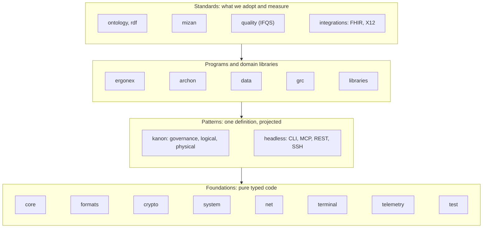
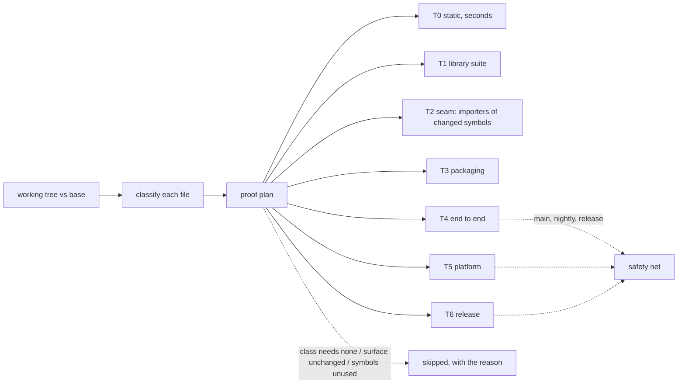

<p align="center">
  <picture>
    <source media="(prefers-color-scheme: dark)" srcset="profile/logos/if-logo-dark-672x189-2026-Sept.png">
    
  </picture>
</p>

# Intellectual Frontiers: `.github`

**Documentation site: <https://intellectual-frontiers.github.io/.github/>**

This public repository is the organization's shared foundation. It holds the [organization profile](profile/README.md) and `commons/`, a set of TypeScript libraries, specifications and ontologies that every company and tool of Intellectual Frontiers builds on. Each library is a folder with a manifest, its own spec kit and its own proof (`bun run verify`), and each is published as a package.
Specifications come first, then the typed ontology, then the code and the tests, and deterministic checks (not an agent's opinion) judge whether they still agree. The documentation site is generated from the code's own documentation and from the specifications, so it is never written by hand.



## The big ideas in 60 seconds

- **Mizan** (Arabic, "balance"): the IF Spec Profile of [GitHub Spec Kit](https://github.com/github/spec-kit). It keeps Spec Kit's method and adds registers, requirement-to-proof tracing and checks, so that the specification, the ontology and the code do not **drift** apart. [`0003-mizan`](commons/spec-kit/specs/0003-mizan/spec.md)
- **Kanon** (Greek, "measure"): the governance of a library is stated once, then projected down into a logical layer and a physical layer, and no annotation is silently dropped: one rule, projected down, nothing lost. A host library has instances (dialects) and plugins. [`0033-kanon`](commons/spec-kit/specs/0033-kanon/spec.md)
- **The ladder**: the architecture of a harness as 11 rungs, 0 to 7 required (ontology, specifications, governed data, data operations, infrastructure rules, business rules, application, documentation), 8 the optional lifecycle, 9 the observer (evidence), 10 the environment (the workspace). A rung relies only on the rungs it names below it. [`0016-ladder`](commons/spec-kit/specs/0016-ladder/spec.md)
- **Standards first**: no invented term where a standard exists, in the order law, US and NIST standards, ISO, broadly used vocabularies, then state and local standards; a term no standard backs is `unaligned`, justified and counted. [`0018-standards-first`](commons/spec-kit/specs/0018-standards-first/spec.md)
- **IFR** (Releases): one scheme of version for each kind of work, and a release that is an annotated Git tag. [`0026-works-versioning`](commons/spec-kit/specs/0026-works-versioning/spec.md)
- **IFQS** (Quality System): what is true of a system is what it reports when it runs, kept as evidence with a grade from E0 to E5. [`0021-ifqs`](commons/spec-kit/specs/0021-ifqs/spec.md)
- **IFCCM** (Capabilities Configuration Management): the capability is the unit of change, and every commit names its issue on a line of its own. [`0020-ifccm`](commons/spec-kit/specs/0020-ifccm/spec.md)
- **Headless**: an action is defined once, with what it may do, and drawn as a command line, a tool server (MCP), a REST service or an SSH-reached command, so a program has no window it cannot do without. [`commons/headless`](commons/headless/about.ts)
- **Repoctl** is the operations program of a repository, driven by a typed `repoctl.config.ts` at its root: the `repoctl` command makes every generated file in dependency order, merges without hand-resolving one, runs every named check in one report, makes the commit with the repository's identity and trailers and says what is wrong with a checkout; where the configuration turns them on it also tells each library's version in the repository, on npm and in its tag, plans and publishes a release, scaffolds a library, proves a change by its blast radius and builds the documentation, as a person types it or as an AI agent calls it through a tool server, by audience tier. It is published to npm, so a repository of your own installs it and writes its own configuration ([the guide](commons/docs/guides/repoctl-in-your-repo.md)). [`commons/repoctl`](commons/repoctl/about.ts)
- **Ergonex** is the front door: the `ergonex` command sets up and runs a team's workspace (repositories, pinned tools, shell) on Windows, macOS and Linux, and shows its plan before it changes anything. [`commons/ergonex`](commons/ergonex/about.ts)

```sh
bunx @intellectual-frontiers/ergonex init                # the workspace root, a starter manifest, and `ergonex` on your path
ergonex repos add github.com/owner/repo                  # put a repository on the list; `ergonex apply` clones it
ergonex doctor                                           # what is wrong, and what to do about it
ergonex setup --dry-run                                  # the plan for the host's tools; `ergonex setup` carries it out
```

Run `ergonex` with no arguments for the next step, `ergonex COMMAND --help` for a command, and `ergonex shell print bash` for the shell snippet (`shell install` writes it to your start-up file). Bun is the default runtime and Node 26 the backup.

## Libraries

<!-- libraries-map:begin -->

| Library | Role | What it is | Kanon | Level | Published to |
| --- | --- | --- | --- | --- | --- |
| [`@intellectual-frontiers/core`](https://www.npmjs.com/package/@intellectual-frontiers/core) | Foundation | Errors as values (`Result`) | - | L1 | GitHub, npm |
| [`@intellectual-frontiers/crypto`](https://www.npmjs.com/package/@intellectual-frontiers/crypto) | Foundation | The digests, signatures and envelopes of commons in pure code on Web Crypto | - | L1 | GitHub, npm |
| [`@intellectual-frontiers/formats`](https://www.npmjs.com/package/@intellectual-frontiers/formats) | Foundation | The file and wire formats of commons | - | L1 | GitHub, npm |
| [`@intellectual-frontiers/githost`](https://www.npmjs.com/package/@intellectual-frontiers/githost) | Foundation | The one interface to a Git host | - | L1 | GitHub, npm |
| [`@intellectual-frontiers/lint`](https://www.npmjs.com/package/@intellectual-frontiers/lint) | Foundation | The lint plugin of Intellectual Frontiers | - | L1 | GitHub, npm |
| [`@intellectual-frontiers/net`](https://www.npmjs.com/package/@intellectual-frontiers/net) | Foundation | The network as one typed library | - | L1 | GitHub, npm |
| [`@intellectual-frontiers/rdf`](https://www.npmjs.com/package/@intellectual-frontiers/rdf) | Foundation | RDF as algebraically typed values | - | L1 | GitHub, npm |
| [`@intellectual-frontiers/system`](https://www.npmjs.com/package/@intellectual-frontiers/system) | Foundation | The host as one typed library | - | L1 | GitHub, npm |
| [`@intellectual-frontiers/telemetry`](https://www.npmjs.com/package/@intellectual-frontiers/telemetry) | Foundation | The OpenTelemetry data model | - | L1 | GitHub, npm |
| [`@intellectual-frontiers/terminal`](https://www.npmjs.com/package/@intellectual-frontiers/terminal) | Foundation | A typed command-line parser (`args`) whose options are declared once as data | - | L1 | GitHub, npm |
| [`@intellectual-frontiers/test`](https://www.npmjs.com/package/@intellectual-frontiers/test) | Foundation | Tests that run unchanged under `bun test` and `node --test` | - | L1 | GitHub, npm |
| [`@intellectual-frontiers/headless`](https://www.npmjs.com/package/@intellectual-frontiers/headless) | Pattern | The contract of a program that has no window | layers | L1 | GitHub, npm |
| [`@intellectual-frontiers/kanon`](https://www.npmjs.com/package/@intellectual-frontiers/kanon) | Pattern | The pattern of a library built in three layers | - | L1 | GitHub, npm |
| [`@intellectual-frontiers/archon`](commons/archon) | Program | A Kanon library that orders subjects: a machine, a device, a workstation or a cloud account | layers, instances, plugins | L1 | held |
| [`@intellectual-frontiers/archon-dialect-ansible`](commons/archon-dialect-ansible) | Program | The dialect of Archon that converges a Linux host with Ansible | layers, extension | L1 | held |
| [`@intellectual-frontiers/archon-dialect-apt`](commons/archon-dialect-apt) | Program | The dialect of tools that installs them with apt | layers, extension | L1 | held |
| [`@intellectual-frontiers/archon-dialect-cloud-init`](commons/archon-dialect-cloud-init) | Program | The dialect of Archon for the unattended install of a machine from nothing | layers, extension | L1 | held |
| [`@intellectual-frontiers/archon-dialect-homebrew`](commons/archon-dialect-homebrew) | Program | The dialect of tools that installs them with Homebrew | layers, extension | L1 | held |
| [`@intellectual-frontiers/archon-dialect-mise`](commons/archon-dialect-mise) | Program | The dialect of tools that installs them with mise | layers, extension | L1 | held |
| [`@intellectual-frontiers/archon-dialect-native-pinned`](commons/archon-dialect-native-pinned) | Program | The default dialect of tools | layers, extension | L1 | held |
| [`@intellectual-frontiers/archon-dialect-winget`](commons/archon-dialect-winget) | Program | The dialect of tools that installs them with WinGet | layers, extension | L1 | held |
| [`@intellectual-frontiers/archon-tool`](commons/archon-tool) | Program | The plugin that gives `archon` its verbs for tools | layers, extension | L1 | held |
| [`@intellectual-frontiers/data`](https://www.npmjs.com/package/@intellectual-frontiers/data) | Program | Governance (what a business domain is and what must be true of its data) | - | L1 | GitHub, npm |
| [`@intellectual-frontiers/docs`](https://www.npmjs.com/package/@intellectual-frontiers/docs) | Program | The generator of a repository's documentation site | - | L1 | GitHub, npm |
| [`@intellectual-frontiers/ergonex`](https://www.npmjs.com/package/@intellectual-frontiers/ergonex) | Program | The one command, `ergonex` | - | L1 | GitHub, npm |
| [`@intellectual-frontiers/estate`](commons/estate) | Program | The assets of an organization (machines, services, accounts) as discovered | layers | L1 | held |
| [`@intellectual-frontiers/evidence-capture`](commons/evidence-capture) | Program | The unattended capture of evidence | layers | L1 | held |
| [`@intellectual-frontiers/grc`](https://www.npmjs.com/package/@intellectual-frontiers/grc) | Program | Governance, risk and compliance in layers | - | L1 | GitHub, npm |
| [`@intellectual-frontiers/integrations`](https://www.npmjs.com/package/@intellectual-frontiers/integrations) | Program | Two families on one skeleton of Kanon layers | layers | L1 | GitHub, npm |
| [`@intellectual-frontiers/integrations-github`](https://www.npmjs.com/package/@intellectual-frontiers/integrations-github) | Program | The reference connector of Integrations for the posture of one organization of a code host | - | L1 | GitHub, npm |
| [`@intellectual-frontiers/lab`](commons/lab) | Program | Disposable machines for tests | layers | L1 | held |
| [`@intellectual-frontiers/libraries`](https://www.npmjs.com/package/@intellectual-frontiers/libraries) | Program | The tools of a repository of commons | - | L1 | GitHub, npm |
| [`@intellectual-frontiers/machine-probe`](commons/machine-probe) | Program | The probe a machine runs for its fleet | layers | L1 | held |
| [`@intellectual-frontiers/netboot`](commons/netboot) | Program | The network boot of a blank machine | layers | L1 | held |
| [`@intellectual-frontiers/package-managers`](commons/package-managers) | Program | The shared kit of the dialects that drive a package manager | layers | L1 | held |
| [`@intellectual-frontiers/repoctl`](https://www.npmjs.com/package/@intellectual-frontiers/repoctl) | Program | The operations program of this repository | layers | L1 | GitHub, npm |
| [`@intellectual-frontiers/toolchain`](commons/toolchain) | Program | A Kanon library of the tools a computer needs | layers | L1 | held |
| [`@intellectual-frontiers/catalog-nist-csf-2`](commons/catalog-nist-csf-2) | Standard | The NIST Cybersecurity Framework 2.0 as a grc catalog package | layers | L1 | held |
| [`@intellectual-frontiers/integrations-fhir`](https://www.npmjs.com/package/@intellectual-frontiers/integrations-fhir) | Standard | The FHIR plugin of Integrations | - | L1 | GitHub, npm |
| [`@intellectual-frontiers/integrations-x12`](https://www.npmjs.com/package/@intellectual-frontiers/integrations-x12) | Standard | The X12 envelope and acknowledgement skeleton of Integrations | - | L1 | GitHub, npm |
| [`@intellectual-frontiers/mizan`](https://www.npmjs.com/package/@intellectual-frontiers/mizan) | Standard | Mizan, the IF Spec Profile, as code | - | L1 | GitHub, npm |
| [`@intellectual-frontiers/ontology`](https://www.npmjs.com/package/@intellectual-frontiers/ontology) | Standard | The ontologies of Intellectual Frontiers Commons | - | L1 | GitHub, npm |
| [`@intellectual-frontiers/quality`](https://www.npmjs.com/package/@intellectual-frontiers/quality) | Standard | The run of a suite of tests as evidence (one OTLP record of the run, its reports as TAP, JUnit, CTRF, SARIF, OSCAL and the documents of ISO/IEC/IEEE 29119-3, and its signed ledger entry) | - | L1 | GitHub, npm |

Metapackages: no code of their own, each depends on a set of the libraries above at exact versions (commons 0036-distribution). Install one of them, or a library.

| Metapackage | What it holds |
| --- | --- |
| [`@intellectual-frontiers/commons`](https://www.npmjs.com/package/@intellectual-frontiers/commons) | Every consumer-facing library of commons as one install, each at an exact version |
| [`@intellectual-frontiers/foundation`](https://www.npmjs.com/package/@intellectual-frontiers/foundation) | The foundation libraries as one install, each at an exact version |
| [`@intellectual-frontiers/patterns`](https://www.npmjs.com/package/@intellectual-frontiers/patterns) | The pattern libraries as one install, each at an exact version |
| [`@intellectual-frontiers/programs`](https://www.npmjs.com/package/@intellectual-frontiers/programs) | The program libraries as one install, each at an exact version |
| [`@intellectual-frontiers/standards`](https://www.npmjs.com/package/@intellectual-frontiers/standards) | The standards libraries as one install, each at an exact version |

<!-- libraries-map:end -->

This table is generated from the manifests (`library.ts`) and the summaries (`about.ts`) of `commons/` by `bun commons/libraries/src/readme.ts`; a test fails where it is stale.

## How other repositories use commons

A repository other than this one gets commons code only by **installing a published package** (commons [0036-distribution](commons/spec-kit/specs/0036-distribution/spec.md)): a public library from npm, a private package (one of a private repository) from the GitHub package registry. It has no Git dependency on this repository, no `file:` or `link:` into a checkout of commons, no vendored copy and no fetch of raw source.

Five **metapackages** install commons as a set, each depending on its libraries at exact versions, so that one version of a metapackage is one coherent release: `@intellectual-frontiers/commons` (every consumer-facing library) and, by role, `foundation`, `patterns`, `programs` and `standards`. Their dependencies are generated from the manifests, never edited by hand. `repoctl hygiene` (`bunx @intellectual-frontiers/repoctl hygiene`, `--json` for CI) runs in any repository and finds a Git or path dependency on commons, a relative import into a copy of it, a vendored copy, two installed copies of one library and a dependency that is not an exact version.

```sh
bun add --exact @intellectual-frontiers/commons@<version>      # or: npm install --save-exact @intellectual-frontiers/commons@<version>
```

A private package comes from the GitHub package registry: a scoped line in `.npmrc` and a token that may read packages in the environment (`ERGONEX_GITHUB_TOKEN`).

```sh
@intellectual-frontiers:registry=https://npm.pkg.github.com
//npm.pkg.github.com/:_authToken=${ERGONEX_GITHUB_TOKEN}
```

The guide [Consuming commons](https://intellectual-frontiers.github.io/.github/guides/consuming-commons.html) says how to install the set, how to upgrade it and how to read a finding of the check.

## Documentation from the code: JSDoc, and lenses

The code is documented as usual, with TSDoc and JSDoc comments on every export (a description, `@example`, `@remarks`, `@limits`), and `check` in [`commons/docs`](commons/docs/) fails an export that has none. The generator reads those comments with the TypeScript checker and makes the API pages from them.

A comment says what a thing is. It cannot show how a model is layered or what a command line offers, so the site also has **lenses**: a lens is a typed value that knows one library, reads its TypeScript *values* in a different way, and makes the pages that way of reading calls for (see [`commons/docs/src/lens.ts`](commons/docs/src/lens.ts)). The generator itself depends on no library it shows; a repository passes its lenses in [`docs.config.ts`](commons/docs.config.ts). The API and specification readers are built into the generator; the layered-model and program lenses are the ones a repository passes. Every page is also written as Markdown beside its HTML, and the models as JSON, for people and for programs.

| Reader | What it reads | What it shows |
| --- | --- | --- |
| **API** (TSDoc) | The exports of each package, their types and comments | One page per package and entity, with signatures, examples and links between them |
| **Layered model** ([`lens/layered.ts`](commons/docs/src/lens/layered.ts)) | The governance, logical and physical values of a Kanon library, such as the data models of `commons/data` | Each model layer by layer, every element with a stable id, where it is written, and the trace from governance down to the table |
| **Program** ([`lens/program.ts`](commons/docs/src/lens/program.ts)) | A program built on `headless`, such as Ergonex, described by `describe(program)` | One page set for each audience tier: every command with its options, operands and examples, and its CLI, MCP and REST forms; a command a tier cannot see is listed with the reason |
| **Specifications** | The spec kit of each library | Every requirement with its identifier, so that code and tests that cite it link back |

## Where to go

- **The documentation site: <https://intellectual-frontiers.github.io/.github/>**, with every package, every specification and the generated API pages.
- **A new developer:** start with the site's overview, then [`AGENTS.md`](AGENTS.md) for how the repository works, and the spec kit of the library you care about.
- **A contributor:** [`AGENTS.md`](AGENTS.md) is the working agreement, and `bun run repoctl` is the command that operates the repository ([`commons/repoctl`](commons/repoctl/about.ts)); the commons specifications are in [`commons/spec-kit/specs/`](commons/spec-kit/specs/) and each library's in its own `spec-kit/`.
- **An AI agent:** read [`AGENTS.md`](AGENTS.md), then the site's [`llms.txt`](https://intellectual-frontiers.github.io/.github/llms.txt); every page of the site has a Markdown twin (`.md` beside the `.html`), and the models and programs have a JSON twin. `repoctl mcp` serves the repository's operations as tools of a tool server, by audience tier.

## Proof proportional to blast radius

A change proves what it can break, and nothing more. `bun run repoctl prove` classifies each changed file, fingerprints the public type surface of the libraries it touches, and computes a **proof plan**: which tiers apply, which tests run and why every skipped proof is safe to skip. The same plan drives the local run and CI.



| The change is | It proves |
| --- | --- |
| a comment, TSDoc or prose | the documentation check |
| specification text, requirement identifiers unchanged | the specification and trace checks |
| a generated file | `sync --check`: the bytes equal the generators' |
| a version or the release record | the versions check |
| inside a library, public types unchanged | T0 and T1 of that library; dependents skip |
| a public signature | T0 and T2 for the importers of the changed symbols only |
| a foundation library (`core`, `system`, ...) | its own proofs and a smoke gate, wider only if the gate fails |
| `exports`, `package.json`, the packer | T3: pack, install, import, type-check |
| the planner, the generators, the tier rules | everything, always |

This is test impact analysis (what a change can reach, from imports and a fingerprint of declarations) joined with consumer-driven contract testing (a consumer declares what it uses by importing it, and a provider's change reaches only those consumers). Results are content-addressed, so an identical key is never run twice, and the end-to-end flows are hermetic. A nightly full run and the release gate remain the safety net, and a plan never skips for a change to the planner itself.

```sh
bun run repoctl prove            # prove what your tree changes since origin/main (tiers T0 to T3 that apply)
bun run repoctl prove --why      # the same, with the reason each proof runs and each skipped proof is safe
bun run repoctl prove --plan     # the plan as JSON, running nothing (what CI reads)
```

[How to read a plan, add a test to the right tier and extend a class](https://intellectual-frontiers.github.io/.github/concepts/proof-by-blast-radius.html).

## Contributing in five commands

```sh
bun install                                   # once, at the root
bun run repoctl check                         # every check of the repository in one report, with a code for `repoctl explain <code>`
bun run repoctl sync                          # every generated file, in dependency order (`sync --check` writes nothing; hooks run it)
bun run repoctl commit -m "Subject" --refs N  # the commit with the repository's identity and trailers (`Refs #N` on a line of its own)
bun run repoctl release plan                  # what the release would do, from the tags (writes nothing)
```

`bun run dev:check` type-checks and tests what your change touches, and `bun run repoctl doctor` says what is wrong with a checkout. A branch is brought up to date with `bun run repoctl merge origin/main`, which makes a conflicting generated file again instead of leaving it to be resolved by hand. Work spec first: change the specification, then the code, then the tests (`commons/spec-kit/specs/`, and each library's own `spec-kit/`).

**Use repoctl in a repository of your own.** Install the package and write the configuration at the root of the repository; the host knows nothing else of it:

```sh
npm install --save-dev @intellectual-frontiers/repoctl   # repoctl.config.ts: export default defineConfig({ repo, commit, generators, checks })
npx repoctl doctor                                       # what is wrong with this checkout, and the command for each
npx repoctl sync --check                                 # which generated files are stale (the generators are the ones you declared)
```

The configuration names the generators, the checks, the commit rules and the optional verbs of that repository (`release`, `new library`, `status`, `prove`, `docs`); [`repoctl.config.ts`](repoctl.config.ts) at the root of this repository is a full example.

## License

The code is public to read and is licensed by Intellectual Frontiers LLC under the [PolyForm Noncommercial License 1.0.0](LICENSE) (SPDX `PolyForm-Noncommercial-1.0.0`), for every library in `commons/` and every other part of this repository.

- **Free**: personal use, research, education, and use by charitable, educational, public research, public safety or health, environmental protection and government organizations, as the license defines them.
- **Needs a commercial license**: any commercial use, hosting, embedding, reselling and building a competing product. Open an issue titled **Commercial license** at <https://github.com/intellectual-frontiers/.github/issues>.
- **Where to read more**: [`LICENSING.md`](LICENSING.md) (in plain words), [`COMMERCIAL.md`](COMMERCIAL.md) (what a commercial license covers), [`NOTICE`](NOTICE), [`CONTRIBUTING.md`](CONTRIBUTING.md) (contributions are licensed to the LLC under the public and commercial licenses; sign off with `git commit -s`) and [`THIRD_PARTY_NOTICES.md`](THIRD_PARTY_NOTICES.md).

Every library folder carries the same `LICENSE`, and every published package declares the same identifier; `bun commons/libraries/src/license.ts` writes them and `--check` proves them. The names Ergonex, Mizan, Kanon, Archon and Stolos and the logos are not licensed beyond saying what the software is.

Nothing here claims compliance with any regulation; it records evidence.
