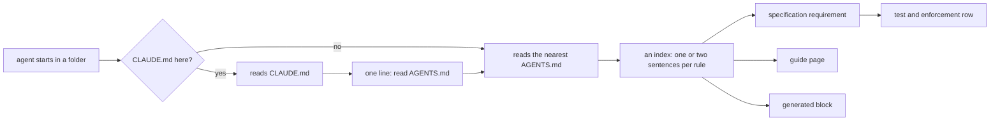

# How AGENTS.md is prepared and used

`AGENTS.md` is the file an agent reads first in this repository. It is a short index of the rules, written so that a person or an agent who has never seen the repository knows what to do next and where each rule is stated in full. This page says what the file is, how the agents that read it find it, how it is prepared here, what lives in it and what lives elsewhere, and how to change it. It is for a senior engineer, a person or an agent, who is new to the repository.

## What the file is

`AGENTS.md` is a convention that several coding agents share. Its home, `agents.md`, says that it is stewarded by the Agentic AI Foundation under the Linux Foundation, and it lists about twenty tools that read it. What the convention standardizes is small: the file name, the fact that files can nest in folders, and that the nearest file to the code an agent works on takes precedence. It does not standardize a schema, a required field, how an agent writes to the file, who may change a rule, or when a rule expires. The content is ordinary Markdown. Everything else on this page is this repository's own practice built on that small convention.

The vendors that read the file are plain about its status. The documentation of Claude Code calls such files "context, not enforced configuration". Codex says that required team guidance belongs in `AGENTS.md` or in checked-in documentation. A rule that must hold is therefore not made to hold by being in this file: it is made to hold by a check, a hook or a gate, and the file points to it.

## How agents read it

Each agent has its own way of finding the file, and the differences matter for how this one is written.

- **Codex** reads the files from the root of the repository down to the folder it works in, and stops adding text at a default cap of 32 KiB. Text past the cap is cut.
- **Claude Code** reads its own `CLAUDE.md`. It reads `AGENTS.md` only where there is no `CLAUDE.md`. This repository therefore has a one-line `CLAUDE.md` that sends it on:

```text source=CLAUDE.md#L1-L1
Read [`AGENTS.md`](AGENTS.md); it is this repository's entry point for any agent.
```

- **Cursor, Kiro, Gemini CLI and others** read the file or an equivalent. Their own guidance on length is similar: under 200 lines for Claude Code's `CLAUDE.md`, under 500 lines for a Cursor rule.
- **A person** reads it as the front door, and follows its links.



Two consequences follow. The file has to stay short, because a long file is truncated by one agent and ignored in part by another. And it has to be an index, because the same file serves agents with different limits and different habits, and the full text of a rule belongs in a place that a person or a check can also read.

## How it is prepared here

The file is prepared on four rules.

**An index of rules, one or two sentences each.** Each bullet states one thing and names where it is stated in full: a requirement of a specification, a guide page, or a generated page. The first bullet, about the development loop, is one sentence and a list of links to the three guides that hold the detail. A reader who needs the detail follows a link. A reader who only needs the rule has it.

**Generated blocks for facts a program owns.** Some facts are written by a program, not by a person, and they sit between marks in the file. The workbench block, the roles, stages and gates of the repository's workbench contract, is the example. The marks are constants in the code that writes the block:

```ts source=commons/workbench/src/logical/project.ts#L16-L17
/** The marks between which the generated block of `AGENTS.md` is kept. */
export const AGENTS_MARKS = { begin: "<!-- workbench:begin -->", end: "<!-- workbench:end -->" } as const;
```

Nobody edits inside the marks: `bun run repoctl sync` writes the block, and a check finds a block that is stale. The same rule is written in the file itself, as one of its bullets:

```text source=AGENTS.md#L17-L19
- **License**: every part of this repository is under `PolyForm-Noncommercial-1.0.0` (0035-licensing); `bun commons/libraries/src/license.ts` writes every `LICENSE`, so never write a license text by hand.
- **Never put a secret, a token or a person's data in this repository: it is public.**
- **A fact a program owns is a generated block between marks** (the libraries map of the README, the workbench block below): never edit inside the marks. What a check can enforce is a requirement with an enforcement row, not prose here.
```

**Nothing that a check can enforce stays only as prose.** A rule that a program can check becomes a requirement of a specification with an enforcement row, one of `check`, `gate`, `review` or `none`, and `none` carries its reason. The rule in `AGENTS.md` then points at the requirement. This is the difference between a rule that is read and a rule that holds. Mizan, the specification method of the repository, keeps the register of these rows; [Mizan in the documentation](concept-mizan.md) describes it.

**A size budget, stated as a finding.** The file is at most 8 KiB and 80 lines, which is inside the limits that the agents that read it document. The check `agents-md` in `repoctl check` reports a file past either budget as a finding that names the file, its size and the budget. A finding is a report and never a failed build: the owner's rule for this repository is that only a typed cause fails a build, and everything else is a finding to read. The check is a short program; its budget is two numbers:

```ts source=commons/tools/agents-md-check.ts#L14-L14
export const BUDGET = { bytes: 8 * 1024, lines: 80 } as const;
```

On the day this page was written the file was cut from 26,532 bytes and 85 lines to under the budget. The numbers below are from commands run that day, the first for the file before the change and the second for the file after it.

```text output="git show 5d687fc6:AGENTS.md | wc -lc; wc -lc AGENTS.md; 2026-11-25"
  85   26532
  54    7559 AGENTS.md
```

No rule was dropped by the change. Each paragraph of the old file went to a place that states it in full: a requirement that already stated it, a guide page, or a new requirement written first. The change is recorded in the issue that tracked it, with the table of where every paragraph went.

## What lives where

`AGENTS.md` is one of several places that hold the repository's knowledge, and each place has one job.

| What | Where it lives | Why there |
| --- | --- | --- |
| The rules an agent follows, as an index | `AGENTS.md` | The one file every agent reads first |
| What the repository must do, stated so that it can be tested | Specifications, as numbered requirements | A requirement can have a test and an enforcement row |
| What enforces each requirement | The enforcement register of each spec kit | It says `check`, `gate`, `review` or `none`, and why |
| Which requirements are met today, and the evidence | The proof register, in OSCAL, written by the checks | It is computed from the tests, so nobody types it |
| The terms the specifications use | The ontology, in TypeScript | A term is defined once, then used |
| A choice that needs a person's authority | A Decision record, signed by the owner | It names who decided and when |
| The state of a body of work | An issue, with every commit naming it | `Refs #N` is checked on every commit |
| Facts a program owns, such as the roles and gates | A generated block between marks | The program writes it, and a check finds it stale |
| How to do a task in a few steps | A guide page in the documentation | It is read by a person and by an agent |

If a fact fits two rows, it belongs in the one that a check can read, and the other row links to it.

## How to change it

A change to `AGENTS.md` is a change to the repository's rules, so it follows the repository's order.

1. **State the rule where it belongs first.** If a check can enforce it, write the requirement in the specification and its enforcement row. If it is a how-to, write it in the guide. Define a term in the ontology before a specification uses it.
2. **Add the pointer to `AGENTS.md`.** One or two sentences, with the link. If a bullet needs a paragraph, the paragraph belongs in a specification or a guide.
3. **Run the checks.** `bun run repoctl sync` and `bun run repoctl check`. The generated block must be unchanged, and the size finding must not appear.
4. **Commit with `bun run repoctl commit -m "Subject" --refs N`.** The commit names its ticket, and the agent that made it is credited in a trailer.

A human or an agent follows the same four steps. The one difference is who may decide a rule that needs the owner's authority: an agent proposes it, and the owner records the Decision. [The Decision on the attribution of agent work](../../spec-kit/audits/2026-11-agent-attribution.md) records what an agent may do on its own and what it leaves to the owner.

## How to keep it short

A longer file is not a better file, for reasons that come from the agents and from the evidence.

- **The limits are documented.** Claude Code's guidance is to keep `CLAUDE.md` under 200 lines and warns that contradictory instructions may be resolved arbitrarily. The default cap of Codex is 32 KiB, and text beyond it is truncated. Cursor's guidance is to keep a rule under 500 lines.
- **Length has a cost.** A study reported in February 2026 on `AGENTS.md` files (arXiv 2602.11988) is summarized by a secondary source as finding slight gains from files that developers wrote and lower success with a higher cost, by more than a fifth, from files that a model generated, and its authors recommend minimal requirements. That summary is the only account of the study this page relies on, and the claim is carried as reported and not verified from the paper.
- **A rule that cannot be followed is worse than none.** A long file hides the one rule that matters among the ones that do not, and an agent that follows half of it gives a confident result that is wrong in an unknown half.
- **A short file can be reviewed.** A person can read fifty lines in a minute and notice that a bullet is wrong. Nobody reviews twenty-five kilobytes on every change.

The test of a bullet is whether it states one thing and links to where it is stated in full. If it does neither, it is a candidate to move.

## Limits of this approach

This page does not claim that an index file is the best possible design. It claims that it fits the evidence found and the limits that agents document.

- **The vendors' pages are mostly undated,** and the behavior of an agent can change between versions. The differences described here, such as Claude Code reading `AGENTS.md` only where there is no `CLAUDE.md`, were true on the day of the research and are written with that day.
- **Agents still treat the file as context.** A rule in `AGENTS.md` can be ignored. The defense is that the rules that matter are also checks, hooks and gates, and the file is not the only line.
- **The file cannot tell an agent what changed since it last read it.** Each session starts from the file as it is. State that changes, such as the status of a body of work, lives in the issue and in the register, which is why [this repository does not use MEMORY.md](why-not-memory-md.md).

## Sources

The pages of the vendors were read on 2026-11-25 through a tool that returns summaries, so a quotation below is what that tool returned. Pages marked undated showed no publication date.

- `agents.md`, the home of the convention, stewarded by the Agentic AI Foundation under the Linux Foundation (undated).
- Claude Code documentation, memory and `CLAUDE.md`: `code.claude.com/docs/en/memory` (undated).
- Codex, the handling of `AGENTS.md`: `learn.chatgpt.com/docs/agent-configuration/agents-md` (undated).
- Cursor, rules: `cursor.com/docs/context/rules` (undated).
- Kiro, steering: `kiro.dev/docs/steering/` (updated 2026-10-21 according to the page).
- Gemini CLI, `GEMINI.md`: `github.com/google-gemini/gemini-cli`, `docs/cli/gemini-md.md` (undated).
- A study of `AGENTS.md` files: arXiv 2602.11988 (2026-02-12, an ICLR 2026 workshop paper); read through a secondary summary and not from the paper.
- Empirical studies of agent instruction files, known only from search summaries: arXiv 2511.12884 (2025-11), arXiv 2510.21413, arXiv 2602.14690.
- The Mizan documentation and the specifications of this repository: `commons/spec-kit/specs/0011-documentation/spec.md`, requirement FR-043 (2026-11-25).
