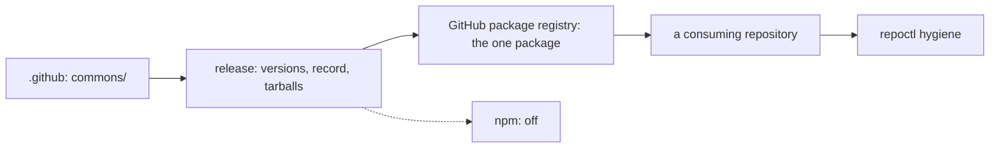

# Consuming commons

A repository other than `.github` uses commons by installing a published package, and by no other route (commons 0036-distribution FR-001). This guide is for the engineer who adds commons to such a repository: the rule and why it exists, how to install the one package, how to set up the registry, how to upgrade it and how to read a finding of `repoctl hygiene`.

## The rule and why

The whole of commons is one package, `@intellectual-frontiers/commons`, published to the GitHub package registry of the organization (distribution `single`, commons 0036-distribution FR-019, FR-028); a public library may also come from npm where the owner turns that target on. A consumer has none of these: a Git dependency on `intellectual-frontiers/.github`, a `file:` or `link:` dependency into a checkout of commons, a vendored copy of a library, a fetch of raw source (commons 0036-distribution FR-002).

The reason is one coherent release. A published version is immutable and carries its declarations and its license; a commit or a checkout carries whatever a branch held that day, and two repositories pinned to two commits hold two commons. A published set also gives the consumer one lockfile entry per library, which is what lets a check find two copies of the same library.



## Install the package

`@intellectual-frontiers/commons` holds every library of commons at one version, compiled, with their declarations and their sources, and the commands `anyfs`, `arcactl`, `ifc-docs`, `ergonex` and `repoctl` (commons 0036-distribution FR-021, FR-024). A library is imported under the package by its name, and each of its subpaths under that (commons 0036-distribution FR-022):

| In the sources of commons | In a consumer |
| --- | --- |
| `@intellectual-frontiers/core` | `@intellectual-frontiers/commons/core` |
| `@intellectual-frontiers/anyfs/governance` | `@intellectual-frontiers/commons/anyfs/governance` |
| `@intellectual-frontiers/data/sql/logical` | `@intellectual-frontiers/commons/data/sql/logical` |

```ts
import { err, ok } from "@intellectual-frontiers/commons/core";
```

Its dependencies are the third-party packages the libraries use and the database drivers they take as ports (DuckDB, PGlite, `pg`) at exact versions, so that a consumer installs no driver itself; the package asks for `@types/node` as a peer where it is type-checked. It runs on Node 26 and on Bun from its compiled files, and Bun reads the sources by the `bun` condition. Pin it as an exact version:

```sh
bun add --exact @intellectual-frontiers/commons@<version>
npm install --save-exact @intellectual-frontiers/commons@<version>
```

The check warns about any `@intellectual-frontiers` dependency that is a range or a tag, because a range lets two releases meet in one tree (commons 0036-distribution FR-014).

## The registry

The package is on the GitHub package registry, which serves the scope `@intellectual-frontiers` to a token that may read packages (commons 0036-distribution FR-028). The consumer maps the scope in `.npmrc` for npm and Node, and in `bunfig.toml` for Bun, and takes the token from the environment; the token is never written in the repository:

```sh
# .npmrc
@intellectual-frontiers:registry=https://npm.pkg.github.com
//npm.pkg.github.com/:_authToken=${NODE_AUTH_TOKEN}
```

```toml
# bunfig.toml
[install.scopes]
"@intellectual-frontiers" = { url = "https://npm.pkg.github.com/", token = "$NODE_AUTH_TOKEN" }
```

Locally the token is a personal access token (classic) with the scope `read:packages`, exported as `NODE_AUTH_TOKEN` (`ERGONEX_GITHUB_TOKEN` where Ergonex supplies it). In a GitHub Actions workflow of a repository that is not `.github` the job's `GITHUB_TOKEN` is used, with `permissions: packages: read`, provided the package grants that repository read access: in the package's settings on GitHub, under "Manage Actions access", the button Add Repository gives the consumer repository the role Read.

## Upgrade

An upgrade is a new version of the package, installed, and then the check.

```sh
bun add --exact @intellectual-frontiers/commons@<new version>
bunx --package @intellectual-frontiers/commons repoctl hygiene
```

A version of any library reaches you only through a new version of the package. Read the release record, `commons/generated/release.auto.json`, to see what a release holds.

## Read a finding of the check

`repoctl hygiene` reads the repository it is run in: its `package.json` files, its lockfile (`bun.lock` or `package-lock.json`), the installed tree and the imports of its sources. It ends with 0, or with 1 where a finding fails; a warning alone does not fail. `--json` prints one document for CI, and `repoctl explain <code>` explains a code (commons 0036-distribution FR-010, FR-012).

| Code | What it says | What to do |
| --- | --- | --- |
| `E-HYGIENE-GIT` | a dependency by Git on `intellectual-frontiers/.github` | install the published package with `--exact` |
| `E-HYGIENE-PATH` | a `file:` or `link:` dependency into a path with a `commons` folder | install the published package instead of linking a checkout |
| `E-HYGIENE-IMPORT` | a relative import that goes through a `commons` folder | import the package by its name |
| `E-HYGIENE-VENDORED` | a folder of the repository carries a package of the scope that is not the repository's own | remove the folder, install the package |
| `E-HYGIENE-DUPLICATE` | one library installed at two versions | add an `overrides` entry for the version you want, install again |
| `E-HYGIENE-RANGE` | a warning: an `@intellectual-frontiers` dependency that is not an exact version | pin it exactly |

A finding names the path it was found at and the command that fixes it. Run the check in CI of every consuming repository so that the rule is held by a job and not by memory.

## Other packages

A package of a private repository is published to the GitHub package registry alone, with `distribution: ["github"]` in its manifest, and is read through the same scoped `.npmrc` line and token (commons 0036-distribution FR-004). In `per-library` mode, which the owner can switch back to (commons 0036-distribution FR-019), each library is a package of its own and five metapackages (`commons`, `foundation`, `patterns`, `programs`, `standards`) install them as sets at exact versions. Writing the registry line during `ergonex init` is planned (commons 0036-distribution FR-016).
