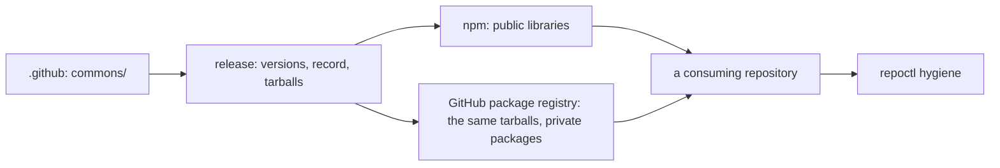

# Consuming commons

A repository other than `.github` uses commons by installing published packages, and by no other route (commons 0036-distribution FR-001). This guide is for the engineer who adds commons to such a repository: the rule and why it exists, how to install the whole set, how to upgrade it, how to read a finding of `repoctl hygiene`, and where private packages come from.

## The rule and why

Public libraries come from npm. Private packages, those of private repositories, come from the GitHub package registry. A consumer has none of these: a Git dependency on `intellectual-frontiers/.github`, a `file:` or `link:` dependency into a checkout of commons, a vendored copy of a library, a fetch of raw source (commons 0036-distribution FR-002).

The reason is one coherent release. A published version is immutable and carries its declarations and its license; a commit or a checkout carries whatever a branch held that day, and two repositories pinned to two commits hold two commons. A published set also gives the consumer one lockfile entry per library, which is what lets a check find two copies of the same library.



## Install the set

Five metapackages have no code of their own. Each depends on its libraries at exact versions, so that one version of a metapackage is one release of commons (commons 0036-distribution FR-005, FR-007).

| Metapackage | Holds |
| --- | --- |
| `@intellectual-frontiers/commons` | every consumer-facing library: the four below together |
| `@intellectual-frontiers/foundation` | [core](../../core/), [crypto](../../crypto/), [formats](../../formats/), [githost](../../githost/), [lint](../../lint/), [net](../../net/), [rdf](../../rdf/), [system](../../system/), [telemetry](../../telemetry/), [terminal](../../terminal/), [test](../../test/) |
| `@intellectual-frontiers/patterns` | [headless](../../headless/), [kanon](../../kanon/) |
| `@intellectual-frontiers/programs` | [data](../../data/) (published as `@intellectual-frontiers/arcactl`), [ergonex](../../ergonex/), [grc](../../grc/), [integrations](../../integrations/), [integrations-github](../../integrations-github/), [libraries](../../libraries/), [repoctl](../../repoctl/) |
| `@intellectual-frontiers/standards` | [integrations-fhir](../../integrations-fhir/), [integrations-x12](../../integrations-x12/), [mizan](../../mizan/), [ontology](../../ontology/), [quality](../../quality/) |

The role of a library decides its set, and `ROLE_OF` in [libraries](../../libraries/) is the one place that gives it (commons 0036-distribution FR-006). Install one set at an exact version, and import each library by its own name:

```sh
bun add --exact @intellectual-frontiers/commons@<version>
npm install --save-exact @intellectual-frontiers/commons@<version>
```

```ts
import { err, ok } from "@intellectual-frontiers/core";
```

Pin the set in your `package.json` as an exact version. The check warns about any `@intellectual-frontiers` dependency that is a range or a tag, because a range lets two releases meet in one tree (commons 0036-distribution FR-014).

## Upgrade

An upgrade is a new version of the metapackage, installed, and then the check.

```sh
bun add --exact @intellectual-frontiers/commons@<new version>
bunx @intellectual-frontiers/repoctl hygiene
```

The metapackage is raised by every release that raises one of its libraries, so a new version of a library reaches you only through a new version of the set. Read the release record, `commons/generated/release.auto.json`, to see what a release holds.

Where one library of your tree is wanted at one version while another package still asks for a range, add an override so that the tree holds one copy:

```json
{ "overrides": { "@intellectual-frontiers/core": "<the version the metapackage names>" } }
```

## Read a finding of the check

`repoctl hygiene` reads the repository it is run in: its `package.json` files, its lockfile (`bun.lock` or `package-lock.json`), the installed tree and the imports of its sources. It ends with 0, or with 1 where a finding fails; a warning alone does not fail. `--json` prints one document for CI, and `repoctl explain <code>` explains a code (commons 0036-distribution FR-010, FR-012).

| Code | What it says | What to do |
| --- | --- | --- |
| `E-HYGIENE-GIT` | a dependency by Git on `intellectual-frontiers/.github` | install the published package with `--exact` |
| `E-HYGIENE-PATH` | a `file:` or `link:` dependency into a path with a `commons` folder | install the published package instead of linking a checkout |
| `E-HYGIENE-IMPORT` | a relative import that goes through a `commons` folder | import the package by its name |
| `E-HYGIENE-VENDORED` | a folder of the repository carries a package of the scope that is not the repository's own | remove the folder, install the package |
| `E-HYGIENE-DUPLICATE` | one library installed at two versions | add an `overrides` entry for the version you want, install again |
| `E-HYGIENE-RANGE` | a warning: an `@intellectual-frontiers` dependency that is not an exact version | pin it exactly |

A finding names the path it was found at and the command that fixes it. Run the check in CI of every consuming repository so that the rule is held by a job and not by memory.

## Private packages

A package of a private repository is published to the GitHub package registry alone, with `distribution: ["github"]` in its manifest. None of the libraries of commons is private. The consumer reads such a package through a scoped registry line in `.npmrc` and a token that may read packages, taken from the environment and never written in the repository (commons 0036-distribution FR-004):

```sh
@intellectual-frontiers:registry=https://npm.pkg.github.com
//npm.pkg.github.com/:_authToken=${ERGONEX_GITHUB_TOKEN}
```

The token variable of Intellectual Frontiers is `ERGONEX_GITHUB_TOKEN`, and the token of a workflow run, `GITHUB_TOKEN`, is not used for it. Writing this line during `ergonex init` is planned (commons 0036-distribution FR-016).
