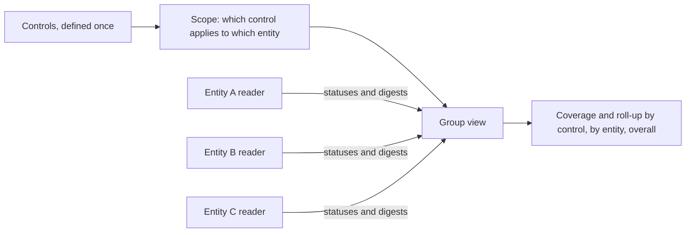
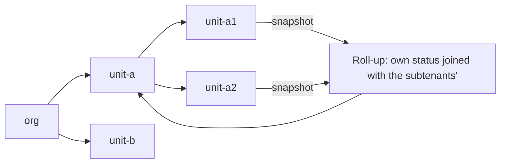

# Govern a group of entities with GRC

A group of entities defines its controls once and scopes them to each entity. Every entity keeps its own ledger, evidence store, signing keys and secrets; the group sees only statuses and digests, read through a function each entity owns ([GRC](../../grc/)).



## The group and its scope

A group is a document of kind `grc.entity-group`: each entity has an identifier and references to its own ports (`ledger`, `store`, `keys`, `secrets`). A reference is a name the host resolves for that entity alone, and a secret is only ever a reference such as `secret:unit-a/signing`; a value in its place does not decode ([commons grc 0009-grc-groups FR-001](../../grc/spec-kit/specs/0009-grc-groups/spec.md)).

The scope is a document of kind `grc.control-scope`. A rule names a control and an entity selector (`all`, `only` or `except`); a control no rule names applies to every entity ([commons grc 0009-grc-groups FR-003](../../grc/spec-kit/specs/0009-grc-groups/spec.md)).

```ts
import { applicability, entityGroup, entityTree, controlScope, scopeProblems } from "@intellectual-frontiers/grc/governance";

// group and scope are documents decoded with entityGroup.decode and controlScope.decode
const built = entityTree(group); // the entities as a tree, or why they are not one
if (built.kind === "ok") {
  const matrix = applicability(built.value, scope, controls); // one cell per control and entity
}
const problems = scopeProblems(group, scope, controls); // [] for a sound scope
```

An exception of a control for an entity is the expiring `grc.exception` that governance already has, with the entity identifier among its `subjects` ([commons grc 0009-grc-groups FR-005](../../grc/spec-kit/specs/0009-grc-groups/spec.md)).

## Reading the group

The host makes one reader for each entity. A reader takes the instant and gives that entity's snapshot, which holds the status, coverage, severity and digests of each control and the head of its ledger, and nothing else. The group never receives an evidence payload or a secret, and no function needs the data of two entities in one place ([commons grc 0009-grc-groups FR-006](../../grc/spec-kit/specs/0009-grc-groups/spec.md), [FR-010](../../grc/spec-kit/specs/0009-grc-groups/spec.md)).

```ts
import { groupView, readGroup } from "@intellectual-frontiers/grc/logical";
import { entityReader } from "@intellectual-frontiers/grc/physical";

const readers = new Map([[unitA, entityReader(portsOfUnitA, material)]]);
const readings = await readGroup(group, readers, at); // an entity with no reader, or that fails, is unread
const view = groupView({ tree, scope, controls, readings, exceptions: [], at });
view.overall.worst; // "pending" while an entity cannot be read, never "pass"
```

An entity that cannot be read gives `pending` and the coverage `unknown`; it is never assumed to pass ([commons grc 0009-grc-groups FR-008](../../grc/spec-kit/specs/0009-grc-groups/spec.md)). Your own way of making readers is proved with `groupConformance`, which runs it over per-entity ports that throw when another entity's reader touches them ([commons grc 0009-grc-groups FR-011](../../grc/spec-kit/specs/0009-grc-groups/spec.md)).

## Subtenants

An entity may have one `parent`, so that the entities of a group form a tree of parents and subtenants. The decoder of `grc.entity-group` refuses a parent the group does not hold and a cycle of parents (a self-parent is a cycle), and `entityTree(group)` is the one constructor of the `EntityTree` that the rest of the model takes: it gives an entity's parent, children, ancestors and descendants in the order of the identifiers, or the fault `duplicate-entity`, `unknown-parent` or `cycle` ([commons grc 0012-grc-subtenants FR-001](../../grc/spec-kit/specs/0012-grc-subtenants/spec.md), [FR-002](../../grc/spec-kit/specs/0012-grc-subtenants/spec.md)).



A control scoped to a parent reaches its subtenants. The nearest explicit rule decides: a rule may state `for` an entity, and it then ranges over that entity and its descendants, so the word of a subtenant wins over the word of its parent; a name in a selector stands for its descendants unless the rule says `inherit: false` ([commons grc 0012-grc-subtenants FR-004](../../grc/spec-kit/specs/0012-grc-subtenants/spec.md), [FR-005](../../grc/spec-kit/specs/0012-grc-subtenants/spec.md)).

```json
{
  "rules": [
    { "control": "urn:grc:ex:1:A-2", "entities": { "kind": "only", "entities": ["unit-a"] } },
    { "control": "urn:grc:ex:1:A-2", "for": "unit-a2", "entities": { "kind": "only", "entities": [] } }
  ]
}
```

Here the control applies to `unit-a` and `unit-a1`, and not to `unit-a2`. An exception is not inherited: it excuses the entities its subjects name, and their subtenants only where it says `inheritable: true` ([commons grc 0012-grc-subtenants FR-007](../../grc/spec-kit/specs/0012-grc-subtenants/spec.md)).

The group view gives each entity its own status and its rolled-up status, the join of its own and its subtenants', with the coverage in the same way, and the roots of the tree. It is made from the snapshots alone, so no evidence is read, and a subtenant that cannot be read is `pending` with the coverage `unknown`, never a pass. Adding a subtenant that fails or cannot be read never improves its ancestors, and entities that are not its ancestors are unchanged ([commons grc 0012-grc-subtenants FR-008](../../grc/spec-kit/specs/0012-grc-subtenants/spec.md), [FR-009](../../grc/spec-kit/specs/0012-grc-subtenants/spec.md), [FR-010](../../grc/spec-kit/specs/0012-grc-subtenants/spec.md)).

```ts
const v = groupView({ tree, scope, controls, readings, exceptions: [], at });
const unitA = v.entities.find((e) => e.entity === unitAId);
unitA?.own; // the status of unit-a itself
unitA?.rolledUp; // the join of unit-a and its subtenants
```

Nothing needs the data of a parent and a subtenant in one store: each reader learns only its own entity's ports, and `groupConformance` refuses a group that is not a tree, checks the roll-up of every entity, and finds a reader that touches the ports of its parent, a sibling or a subtenant ([commons grc 0012-grc-subtenants FR-011](../../grc/spec-kit/specs/0012-grc-subtenants/spec.md), [FR-012](../../grc/spec-kit/specs/0012-grc-subtenants/spec.md)).

## The state at an instant

`asOf(input, at)` gives the status, coverage, freshness, exceptions in force and risk of every control at an instant, from what was recorded up to it. Events after the instant are ignored and expirations are judged at the instant, so the view at the end of the ledger equals the current view and a later event never changes an earlier one ([commons grc 0010-grc-as-of FR-006](../../grc/spec-kit/specs/0010-grc-as-of/spec.md)).

```ts
import { asOf } from "@intellectual-frontiers/grc/logical";

const view = asOf(input, "2026-03-01T00:00:00Z");
```

## Verifying a bundle offline

`grc bundle verify` checks a whole evidence bundle with no network: each item's hash and size, the ledger's hash chain, the canonical form, the signature and the signer's role and custody, and the retention of the evidence. Each fault is a finding that names the item, entry, signature or file it concerns, with a code that `grc explain` explains ([commons grc 0011-grc-bundles FR-003](../../grc/spec-kit/specs/0011-grc-bundles/spec.md)).

```sh
grc bundle verify ./bundle --keys keys.json --policy policy.json --at 2026-06-01T00:00:00Z
grc explain E-BUNDLE-ITEM-HASH-MISMATCH
```

The exit is 0 when the bundle verifies, 1 when there are findings, 2 for a wrong command line and 3 when a folder or file cannot be read ([commons grc 0011-grc-bundles FR-011](../../grc/spec-kit/specs/0011-grc-bundles/spec.md)). The keys and the policy are the verifier's: a bundle never vouches for its own signer.
