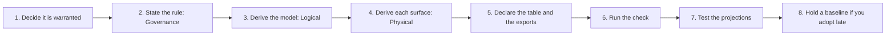

# Adopting Kanon in a library

This page builds a Kanon library from nothing, step by step. The library is the small one used on the [imports page](kanon-imports.md): `commons/kanon/suite/examples/reminders`. It is a real folder, tested by the Kanon library's own suite, so every block below is code that runs and a test fails if a block drifts from its file.



## 1. Decide that it is warranted

Kanon adds structure. It pays where **one rule is carried into several places** or where a library **expects extensions**. If you have one place and no extensions, you do not need it. [The decision guide](kanon-decision-guide.md) has the test and the checklist. The example has one rule (what a reminder action is and may do) carried into two places (a command line and a tool server), which is the smallest case that is worth the layers.

## 2. State the rule once: Governance

Write what the thing is and what it may do as **data**, in the words of the domain, in a folder of its own. Nothing in this folder imports another unit of the library.

*Source: `commons/kanon/suite/examples/reminders/src/governance/reminder.ts`, lines 8 to 28.*

```ts source=commons/kanon/suite/examples/reminders/src/governance/reminder.ts#L8-L28
/** What an action may do to the world. */
export type Effect = "read" | "mutate" | "destructive";

/** One action and the facts that govern it. */
export type Action = {
  /** Its words as a person types them. */
  readonly id: string;
  readonly summary: string;
  readonly effect: Effect;
  /** Whether running it again with the same input changes nothing more. */
  readonly idempotent: boolean;
  /** An annotation: what must be recorded when it runs (FR-005 of 0033-kanon: each annotation ends expressed, carried or unexpressed). */
  readonly audit: string;
};

/** The actions of the example: the one place that says what they are. */
export const ACTIONS: readonly Action[] = [
  { id: "reminder list", summary: "List the reminders.", effect: "read", idempotent: true, audit: "not recorded: a read" },
  { id: "reminder add", summary: "Add a reminder.", effect: "mutate", idempotent: false, audit: "the change is recorded with who made it" },
  { id: "reminder clear", summary: "Remove every reminder.", effect: "destructive", idempotent: true, audit: "the change is recorded with who made it" },
];
```

Three actions, with their effect, whether they are safe to repeat, and an annotation, `audit`, saying what must be recorded when they run. This is the only file that says what `destructive` means for a reminder.

The folder exposes a public entry, so other units import it by name:

*Source: `commons/kanon/suite/examples/reminders/src/governance/mod.ts`, lines 7 to 7.*

```ts source=commons/kanon/suite/examples/reminders/src/governance/mod.ts#L7-L7
export { ACTIONS, type Action, type Effect } from "./reminder.ts";
```

## 3. Derive the model: Logical

The Logical layer makes the model a program reasons with, **by a function** from Governance. It does not copy a single value by hand.

*Source: `commons/kanon/suite/examples/reminders/src/logical/verbs.ts`, lines 9 to 33.*

```ts source=commons/kanon/suite/examples/reminders/src/logical/verbs.ts#L9-L33
/** The model of an action: its words, and what a caller must know before running it. */
export type Verb = {
  /** The id of the action it was made from (the trace edge of 0033-kanon FR-003). */
  readonly from: string;
  readonly words: readonly string[];
  readonly summary: string;
  readonly readOnly: boolean;
  readonly destructive: boolean;
  readonly idempotent: boolean;
};

/** The projection of one action into one verb. */
export function verbOf(a: Action): Verb {
  return {
    from: a.id,
    words: a.id.split(" "),
    summary: a.summary,
    readOnly: a.effect === "read",
    destructive: a.effect === "destructive",
    idempotent: a.idempotent,
  };
}

/** The model of the whole program: a verb for each action, in the order of Governance. */
export const VERBS: readonly Verb[] = ACTIONS.map(verbOf);
```

`verbOf` is the projection. The field `from` is the id of the action the verb was made from, so each verb carries its trace edge. `VERBS` is the model of the whole program, made by mapping `verbOf` over Governance's list.

## 4. Derive each surface: Physical

Each surface makes its output from the model and imports Logical and Governance, and no other surface.

*Source: `commons/kanon/suite/examples/reminders/src/physical/cli/command.ts`, lines 7 to 15.*

```ts source=commons/kanon/suite/examples/reminders/src/physical/cli/command.ts#L7-L15
import { type Verb, VERBS } from "@example/reminders/logical";

/** The usage line of a verb: a destructive verb asks for `--yes`. */
export function usageOf(v: Verb): string {
  return `${v.words.join(" ")}${v.destructive ? " --yes" : ""}   ${v.summary}`;
}

/** The help of the program: one line for each verb. */
export const HELP: readonly string[] = VERBS.map(usageOf);
```

*Source: `commons/kanon/suite/examples/reminders/src/physical/tool/tool.ts`, lines 7 to 26.*

```ts source=commons/kanon/suite/examples/reminders/src/physical/tool/tool.ts#L7-L26
import { type Verb, VERBS } from "@example/reminders/logical";

/** A tool as a client lists it. */
export type Tool = {
  readonly name: string;
  readonly description: string;
  readonly annotations: { readonly readOnlyHint: boolean; readonly destructiveHint: boolean; readonly idempotentHint: boolean };
};

/** The tool of a verb: the words joined by underscores, and the hints from the model. */
export function toolOf(v: Verb): Tool {
  return {
    name: v.words.join("_"),
    description: v.summary,
    annotations: { readOnlyHint: v.readOnly, destructiveHint: v.destructive, idempotentHint: v.idempotent },
  };
}

/** The tools of the program: one for each verb. */
export const TOOLS: readonly Tool[] = VERBS.map(toolOf);
```

The tool's three hints are not written by anyone. They come from the verb, which comes from the action. If the effect of `reminder clear` changes in Governance, the command-line usage line and the tool's hint change with it, and a test compares them.

## 5. Declare the table and the exports

The table lists the units, each in one layer, and what each surface may import. This is the whole of it for the example:

*Source: `commons/kanon/suite/examples/reminders/kanon.ts`, lines 8 to 17.*

```ts source=commons/kanon/suite/examples/reminders/kanon.ts#L8-L17
export const kanon = {
  package: "@example/reminders",
  units: [
    { folder: "./", own: true },
    { folder: "src/governance/", layer: "governance" },
    { folder: "src/logical/", layer: "logical" },
    { folder: "src/physical/cli/", layer: "physical", mayImport: ["src/governance/", "src/logical/"] },
    { folder: "src/physical/tool/", layer: "physical", mayImport: ["src/governance/", "src/logical/"] },
  ],
};
```

A library that is Kanon in the Commons repository writes the same object as the field `kanon` of its manifest `library.ts`, and its `verify` script runs the check. A package that only consumes the pattern writes it as `kanon.ts`, as here.

The units import each other by package name, so the package declares the public entries in `package.json`:

```json
{
  "exports": {
    "./governance": "./src/governance/mod.ts",
    "./logical": "./src/logical/mod.ts",
    "./cli": "./src/physical/cli/mod.ts",
    "./tool": "./src/physical/tool/mod.ts"
  }
}
```

## 6. Run the check

From the library's folder:

```text
bun ../kanon/src/check.ts            check the library in the working folder
bun ../kanon/src/check.ts --root DIR the library's folder
bun ../kanon/src/check.ts --write-baseline   hold what is found now in kanon.baseline.txt (the first time only)
```

The exit status is 0 where nothing is new or stale, 1 where something is, and 2 where the table cannot be read. On the example:

```text output="bun src/check.ts --root examples/reminders (run in commons/kanon); 2026-11-24"
kanon-check: passed: 0 new, 0 stale, 0 held by kanon.baseline.txt
kanon-check: import result ok
```

Add the command to the library's `verify` script, so a library that is Kanon cannot pass `verify` without passing the check. The specification requires the check of the manifests to find a library that declares `kanon` and whose `verify` does not run it.

## 7. Test the projections

The import check keeps the layers apart. It cannot tell whether a projection is right. Write the tests that compare each surface with the model, as Headless does. The example's test does it for the three actions:

*Source: `commons/kanon/suite/examples.test.ts`, lines 48 to 60.*

```ts source=commons/kanon/suite/examples.test.ts#L48-L60
proves(["0001-kanon-checker FR-019"], "each projection of the example is made from the action of Governance: a verb, a usage line and a tool for each, with the hints of its effect", () => {
  assertEquals(VERBS.map((v) => v.from), ACTIONS.map((a) => a.id));
  assertEquals(HELP.length, ACTIONS.length);
  assertEquals(TOOLS.length, ACTIONS.length);
  for (const a of ACTIONS) {
    const tool = TOOLS.find((t) => t.name === a.id.split(" ").join("_"));
    assert(tool !== undefined, `a tool for ${a.id}`);
    assertEquals(tool.annotations.readOnlyHint, a.effect === "read");
    assertEquals(tool.annotations.destructiveHint, a.effect === "destructive");
    assertEquals(tool.annotations.idempotentHint, a.idempotent);
  }
  assertStringIncludes(HELP.join("\n"), "reminder clear --yes");
});
```

For each action the test finds its tool and checks that each hint is the fact it should be, and that the help includes the confirmation a destructive command needs. If someone writes a tool by hand and gets one of these wrong, this test fails, and the check of imports would not have noticed.

## 8. Hold a baseline if you adopt late

A library that already exists will have findings on the first run. Run `--write-baseline` once. The check then fails on a **new** finding and also on a baseline line that **does not occur**, so the baseline can only shrink. The baseline's own header says never to add a line to make a check pass. Treat the file as a list of debts with an owner, and pay them down. [The weaknesses page](kanon-weaknesses.md) says what happens when nobody does.

## What you now have

- A rule stated once, as data.
- A model and two surfaces made from it by functions.
- A table that a program checks in under a second.
- Findings with a code, a file and a line when a unit reaches where it should not.
- Tests that compare each surface with the model.

## Adding the next surface

To add a REST surface: add a folder `src/physical/rest/`, add a unit to the table with `mayImport` listing Governance and Logical, add the entry to `exports`, and write the function from the verb to the operation. The check will refuse the new surface if it imports the command line or the tool server. An agent can do this in one folder, and the table tells it exactly what that folder may import.

## Adding a backend to a library that is a host

If the library expects extensions, declare a `family` in its table, list the plugins, and give each extension its own package with `extends` set to the host. [The families page](kanon-families.md) has the real manifests.

Next: [what consumers gain](kanon-gains.md).
