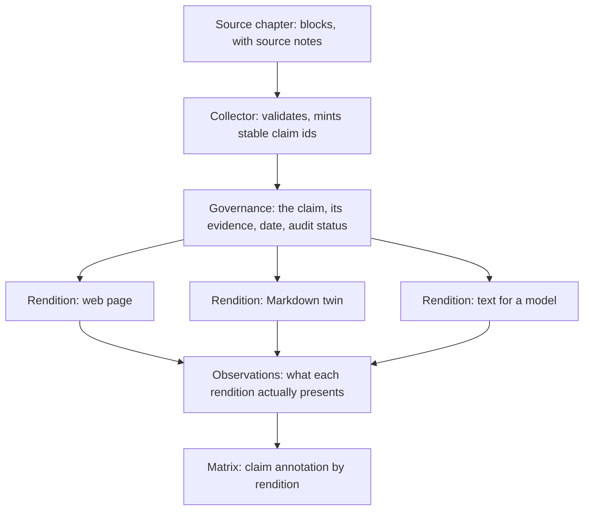

# Content and renditions

Kanon was first used for code. The same shape fits **published content**: a claim in a book chapter, a page on a website, the same page as plain Markdown, a feed or a text file for a language model. The rule that Kanon states for code, state a thing once and carry it down without losing anything, is the rule a publisher needs for a **dated, sourced claim**.

This page describes the Content library, `@intellectual-frontiers/content`. It is built and tested against synthetic input. The method it serves, [the content method](../../spec-kit/specs/0039-content-method/spec.md), is a draft, and a production rollout on a real website is draft work, so this page marks what is exercised and what is not.

## The problem: a claim shows up in several renditions

A public claim, such as "this measurement was taken in a controlled example", carries things with it: the evidence behind it, the date it was true, whether anyone has audited it. A page that publishes the claim as HTML may show the citation. The same claim published as Markdown for a crawler, or as a text file for a model, may silently lose it. Nobody decides to drop the citation. A template changes, and one rendition stops showing it.

That is the same defect as a tool descriptor that stops carrying a destructive hint, and Kanon's answer is the same.

| Kanon idea | In code | In content |
| --- | --- | --- |
| Governance | an action and its effect | a **claim** and its evidence, date and audit status |
| Logical | the verb a program reasons with | the **collected claim**, validated and given a stable id |
| Physical surface | a command, a tool, a route | a **rendition**: the web page, its Markdown twin, a feed |
| Annotation | effect, audience | evidence, as-of date, audit status |
| Instance | a dialect for a database | each rendition of the claim |
| Matrix | requirement by dialect | **claim annotation by rendition** |



## Governance: the claim

The Governance layer of the library is data. A claim has an id, its text, where it came from, a label (evidence, vendor documentation, inference, hypothesis, opinion, illustration), the evidence sources it names, a date it was true, a date by which it should be checked again, how volatile the fact is, and its audit state.

```ts source=commons/content/src/governance/mod.ts#L33-L46
export type Claim = {
  readonly id: string;
  readonly minted: boolean;
  readonly text: string;
  readonly file: string;
  readonly line: number;
  readonly label: (typeof CLAIM_LABELS)[number];
  readonly audience: string;
  readonly evidence: readonly EvidenceSource[];
  readonly asOf?: string;
  readonly reverifyBy?: string;
  readonly volatility: (typeof VOLATILITY)[number];
  readonly audit: (typeof AUDIT_STATES)[number];
};
```

Two defaults matter. A claim with no stated audit status is **not audited**, and the collector says so on every claim. A claim a source did not give an id gets a **stable ordinal id** minted from its place in the chapter. Malformed markers, duplicate ids and unresolved evidence are findings, each with the source location.

## Logical: the collector

The collector accepts the blocks of a chapter from a structural parser, with their source locations, and returns the claims it validated and the findings it raised. A block marked restricted is withheld: the collector never turns it into a claim. The collector does not read the clock. The caller supplies the day, so the same input gives the same output.

## Physical: renditions and what they observe

A rendition is observed from its **output**, not its source. An observation is what a rendition actually presents about a claim: which evidence it shows, which date, which audit status.

```ts source=commons/content/src/physical/rendition/mod.ts#L11-L19
export type Observation = {
  readonly claim: string;
  readonly evidence?: readonly string[];
  readonly asOf?: string;
  readonly audit?: Claim["audit"];
};

/** Output observations for a named rendition, such as web or markdown. */
export type Rendition = { readonly name: string; readonly observations: readonly Observation[] };
```

The assembly step takes the claims and the observations of each rendition, projects each claim through a Logical element to each rendition, and compares what each rendition shows with what the claim carries. For each annotation and each rendition the result is one of the endings from [the trace page](kanon-trace-and-dropped.md): expressed, carried, unexpressed or dropped.

Here is the scenario that the library's test uses. A claim has one evidence source. The web page shows it. The Markdown twin shows an empty list.

```ts source=commons/content/suite/content.test.ts#L29-L39
  const { claims } = collectChapter({ ...chapter, blocks: [publicBlock] }, "2026-11-22");
  const claim = claims[0];
  assert(claim !== undefined);
  const output = assembleContent("pilot", claims, [
    { name: "web", observations: [{ claim: claim.id, evidence: claim.evidence.map((e) => e.url), audit: claim.audit }] },
    { name: "markdown", observations: [{ claim: claim.id, evidence: [], audit: claim.audit }] },
  ]);
  assert(output.kind === "ok");
  assertEquals(output.value.findings.map((f) => f.rule), ["kanon/dropped"]);
  const evidence = output.value.matrix.rows.find((row) => row.annotation === "evidence");
  assertEquals(evidence?.cells.map((cell) => [cell.instance, cell.cell.outcome]), [["web", "expressed"], ["markdown", "dropped"]]);
```

This is the real output of the assembly for that input, using synthetic data:

```text output="matrixMarkdown and the findings of assembleContent over the synthetic claim of commons/content suite/content.test.ts (a throwaway script run in commons/content); 2026-11-24"
| Requirement | Annotation | web | markdown |
| --- | --- | --- | --- |
| claim:pilot/chapter/m1 (claim:pilot/chapter/m1) | evidence | expressed (web:claim:pilot/chapter/m1) | dropped |
| claim:pilot/chapter/m1 (claim:pilot/chapter/m1) | audit | expressed (web:claim:pilot/chapter/m1) | expressed (markdown:claim:pilot/chapter/m1) |

3 expressed, 0 carried, 0 unexpressed, 1 dropped

kanon/dropped | claim:pilot/chapter/m1 has the annotation evidence for the instance markdown, and no lower element expresses it or carries it, and nothing names it as unexpressed
```

The matrix exposes the gap exactly: the Markdown twin of the claim has dropped the evidence, while its audit status is intact. The finding names the claim, the annotation and the rendition. A person fixing the template, or an agent asked to, knows which rendition to open and which annotation to restore.

## Why observe the output

A model can say that a rendition carries the citation, and the rendition can still fail to. The matrix compares what each rendition presents with what the claim carries, so the check holds even when a template is changed by someone who never saw the model. The limit is the observation itself: the check is as good as the code that reads a rendition's output. An observer that reads the wrong place passes a broken page.

## The model travels as a verified bundle

The library can publish the Logical model as a **bundle**: a set of files and a manifest that lists every file with its SHA-256 and size. The serialization is deterministic: the same model gives the same bytes. A loader verifies the whole bundle against its manifest and refuses it entirely if any file differs. This lets a renderer in another process, or another repository, load the model without trusting the transport. In the library's test, replacing one file of the bundle with an empty file makes the loader refuse it.

## The gate: a finding is not a failure

What a finding does to a build is a decision of the host that runs the check, not a property of the finding. Kanon gives the same findings under any policy. The Content library states its policy as a small typed value:

```ts source=commons/content/src/logical/mod.ts#L118-L132
/** Owner policy for escalating unaccounted evidence. */
export type ContentGatePolicy = {
  readonly until: string;
  readonly reviewedOn?: string;
  readonly decision?: { readonly by: "shah"; readonly on: string; readonly mode: "fail-build" };
};

/** The date at which an unreviewed policy needs a decision. */
export const CONTENT_GATE_POLICY: ContentGatePolicy = { until: "2027-01-31" };

/** Determine the policy for unaccounted evidence on an explicit day. */
export function contentGateDecision(today: string, policy: ContentGatePolicy = CONTENT_GATE_POLICY): { readonly mode: "warn" | "fail-build"; readonly reviewDue: boolean } {
  if (policy.decision?.by === "shah" && day(policy.decision.on) && today >= policy.decision.on)
    return { mode: "fail-build", reviewDue: false };
  return { mode: "warn", reviewDue: today > policy.until && (policy.reviewedOn === undefined || policy.reviewedOn < policy.until) };
```

Until the date, a claim whose evidence no rendition accounts for **warns**. After the date, with no recorded decision, the finding stays a warning and a separate **review is due** finding appears. Only a dated decision recorded by the owner changes the mode to fail-build, and the date alone never starts a hold. This is consistent with the build policy of this repository: a finding is reported, and a build fails only for a typed cause.

## What is built, and what is not

- **Built and tested on synthetic input:** the collector, the assembly, the matrix, the findings, the deterministic bundle and the gate policy.
- **Exercised on an HTML and Markdown fixture** for a website, in the first consumer's repository.
- **Draft:** the content method, the author markers and the licensing vocabulary. The production rollout on the real website is not done.
- **Not covered:** how a rendition is observed in a real browser, or how a crawler sees a page. The observers are the consumer's code.

## Why this is the same pattern

A claim is stated once, in Governance. Each rendition is a projection. The matrix is the accounting that nothing was dropped. An agent that edits a rendition is held by the same kind of finding that holds an agent editing a command line: a code, a place and one sentence.

Next: [adopting Kanon in a library](kanon-adopting.md).
