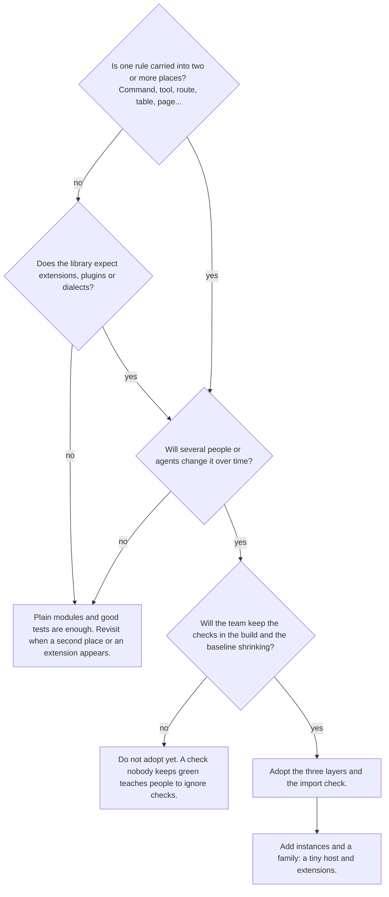

# Decision guide and FAQ

This page helps you decide whether to use Kanon, in which library, and how far. It ends with the questions a skeptical architect asks, with honest answers.

## The decision in one picture

Read it as a default and not a law. The questions are the ones that decide whether the structure pays for itself.

## When to adopt

- **One rule, several places.** A statement of what an action is and may do appears in a command line, a tool server, a web interface and documentation.
- **A model and several implementations.** A library with a dialect for each database, a backend for each store, or a rendition for each medium.
- **Many contributors, human and machine.** Where no one holds the whole system in mind, a boundary that a program enforces is cheaper than one that a reviewer remembers.
- **Promises that must not be lost.** Effects, audiences, retention, audit: properties of the top layer that every implementation has to honour or say it does not.
- **A library that will grow by extension.** Where new backends and tools should be new packages and not edits to the core.

## When not to adopt

- A small library with one implementation and no expected extensions.
- A prototype or a script whose life is shorter than the cost of the table.
- A domain that is still being discovered, where what belongs in Governance is not yet known.
- A codebase that is not TypeScript, if the aim is the automated check.
- A team that will not keep the checks in the build.

## How far to go

Adoption is a ladder, and each step is useful by itself.

| Step | What you add | What you get |
| --- | --- | --- |
| 1 | The three layers and the table, and the import check | One-way imports with findings, in under a second |
| 2 | Projection by code and tests against the model | One place for each rule, with a test that notices a copy |
| 3 | Stable ids and the trace graph | A path from any physical element to its reason |
| 4 | Dispositions and the matrix | An account of every promise, for each implementation |
| 5 | Instances and a family | A tiny host with extensions, each in its own package |
| 6 | A bundle of the model, and a gate policy | A verified model carried between processes, and a decision about what findings do |

Most libraries need step 1 and 2. Steps 4 to 6 are for hosts and for content.

## Adoption checklist

1. Name the rule or rules that are carried into several places.
2. Write them as Governance data, in the words of the domain.
3. Derive the model and each surface by functions, with no hand-written copies.
4. Declare the table, and the exports that make the boundary.
5. Run the check, add it to `verify`, and write a baseline only if you must.
6. Write a test for each surface that compares it with the model.
7. Give each baseline line an owner and a date.
8. If a second implementation or an extension appears, add an instance or a family, and the matrix.
9. Say, in the library's notes, what the check cannot see.

## FAQ

**How is this different from a layered architecture or a hexagonal one?**
The direction of dependencies, and the ports and adapters, are the same family of ideas, and Kanon uses them. Kanon adds two things that layering by itself does not say: **projection**, that a lower layer is derived from the one above by code and not restated, and **identity**, that every element has a stable id and a trace to its source. It also adds the account of each promise (expressed, carried or unexpressed) and a program that checks all of it.

**Do I need a special tool?**
The checker is a library, `@intellectual-frontiers/kanon`, and a command that runs on Bun and on Node 26. It reads TypeScript. A library declares its table as data and runs the command in its `verify`.

**How much code does it take?**
The example library on the [adopting page](kanon-adopting.md) has three actions, a model, a command-line surface and a tool surface, in nine TypeScript files and 66 lines of code excluding comments and blank lines. That is the smallest case that is worth the layers. A library that is Kanon in this repository is larger, because its domain is.

**Can I adopt it in an existing codebase?**
Yes. Run the check, write a baseline of what it finds, and let the baseline shrink. The check fails on a new finding and on a baseline line that does not occur, so existing debt does not block you and new debt does.

**Can I use only the import check?**
Yes. Steps 1 and 2 of the ladder give you most of the benefit for most libraries. The matrix and the families are for libraries that need them.

**Who owns Governance?**
Whoever owns the domain. It is data in the words of the domain, so a domain expert can read it. A change to it is a change to a rule, and its tests are the ones that compare the projections.

**What if the layers disagree?**
They cannot disagree by derivation, because the lower layer is made from the upper one. Where a hand-written value has crept in, a projection test fails. Where a lower layer cannot honour a promise, the disposition says unexpressed and gives the reason.

**Does it slow the build?**
On this repository, one check takes about half a second, and all 58 checks took 20 seconds in total. The cost that matters is the tests you write, not the check.

**Does it help with AI agents specifically?**
It helps where the problem is an agent reaching further than its task or restating a rule. It gives the agent a boundary, a finding when it crosses it, and a set of promises to account for. It does not make the agent's logic correct. [What consumers gain](kanon-gains.md) lists what is measured and what is an expectation.

**What about the specification being a Draft?**
Treat the manifest's table and the check as the contract that runs today. The specification's open questions are listed in it. Adopting the first steps of the ladder commits you to little, and the later steps are where details may still change.

**How does it relate to Mizan and the ladder?**
Mizan is the method for specifications, ontology and standards across a whole harness. The [ladder](mizan-ladder.md) is the rule that a rung relies only on the rungs below it. Kanon applies the same idea inside one library and adds projection and identity. A rung is never a layer, and the numbers of the two are not compared.

**Why is it called Kanon?**
It is an internal working name for the pattern and its library. No registry or trademark clearance was sought.

**Where do I start?**
Read [the one page](kanon-one-page.md), run [the example](kanon-adopting.md), then decide with the questions at the top of this page.

Next: [glossary and sources](kanon-glossary.md).
