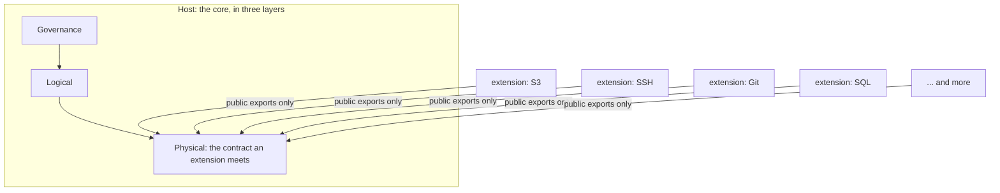

# Families, hosts and plugins: a tiny core

The three layers keep one library coherent. A **family** keeps a library coherent as it grows: a small host that states the rules once, and many extensions, each a package of its own, that reach the host only through its public surface.

This is the second reason Kanon exists, and the pattern that suits a library of medium or high complexity: **extensions, plugins and dialects on a tiny core.**



The arrows run from the extension to the host, never the other way. The host does not import an extension, and an extension does not import the files of the host: it imports what the host's `package.json` exports.

## The vocabulary

- A **host** is a library that is Kanon and is extended by packages of its own.
- An **extension** is a package that extends a host, through the host's public `exports` only.
- A **plugin** is an extension that adds a noun to the host's one program. AnyFS has plugins for `s3`, `ssh`, `git` and the rest. A plugin may depend on other plugins, by declaration.
- A **dialect** is an extension that is an **instance** of one of the host's physical units. Archon has a dialect for each tool it drives: `apt`, `homebrew`, `mise`, `winget`, `ansible`, `cloud-init`, `opentofu` and `native-pinned`.
- A **family** is the host with its extensions, and the **naming rule** of their packages, which is data of the host's table.

## The host declares the family

Here is how AnyFS, the host, declares itself. Its manifest says it is the host of its family, gives the naming rule, and lists its plugins by noun, with dependencies where one plugin needs another.

*Source: `commons/anyfs/library.ts`, lines 20 to 24.*

```ts source=commons/anyfs/library.ts#L20-L24
  kanon: {
    package: "@intellectual-frontiers/anyfs",
    family: { dialect: "{host}-dialect-{name}", plugin: "{host}-{name}" },
    instances: [],
    plugins: [{ noun: "bridge" }, { noun: "cli", dependsOn: ["bridge", "posix", "serve", "ssh"] }, { noun: "git" }, { noun: "gdrive" }, { noun: "githost" }, { noun: "onedrive" }, { noun: "posix" }, { noun: "query" }, { noun: "s3" }, { noun: "serve", dependsOn: ["posix"] }, { noun: "sql" }, { noun: "ssh" }],
```

The `family` line is the naming rule: a plugin's package is named `{host}-{name}`, so the plugin `s3` is the package `@intellectual-frontiers/anyfs-s3`, and a dialect would be named `{host}-dialect-{name}`. The package of a member is **made from the rule and never written a second time**, so a package whose name the rule does not make is `family/name`.

Archon declares eight dialects, each an instance of the same physical unit, placed in a package of its own, and four plugins:

*Source: `commons/archon/library.ts`, lines 20 to 33.*

```ts source=commons/archon/library.ts#L20-L33
  kanon: {
    package: "@intellectual-frontiers/archon",
    family: { dialect: "{host}-dialect-{name}", plugin: "{host}-{name}" },
    instances: [
      { name: "native-pinned", instanceOf: "src/physical/dialect/", placement: "package" },
      { name: "apt", instanceOf: "src/physical/dialect/", placement: "package" },
      { name: "homebrew", instanceOf: "src/physical/dialect/", placement: "package" },
      { name: "mise", instanceOf: "src/physical/dialect/", placement: "package" },
      { name: "winget", instanceOf: "src/physical/dialect/", placement: "package" },
      { name: "ansible", instanceOf: "src/physical/dialect/", placement: "package" },
      { name: "cloud-init", instanceOf: "src/physical/dialect/", placement: "package" },
      { name: "opentofu", instanceOf: "src/physical/dialect/", placement: "package" },
    ],
    plugins: [{ noun: "tool" }, { noun: "converge" }, { noun: "boot" }, { noun: "dns" }],
```

## The extension declares what it extends

An extension has its own manifest and its own table. It says which host it extends and what it holds. This is the whole of the S3 backend's declaration:

*Source: `commons/anyfs/s3/library.ts`, lines 17 to 17.*

```ts source=commons/anyfs/s3/library.ts#L17-L17
  family: { host: "anyfs", role: "plugin" },
```

*Source: `commons/anyfs/s3/library.ts`, lines 20 to 29.*

```ts source=commons/anyfs/s3/library.ts#L20-L29
  kanon: {
    package: "@intellectual-frontiers/anyfs-s3",
    extends: "@intellectual-frontiers/anyfs",
    units: [
      { folder: "src/", layer: "physical" },
      { folder: "suite/", own: true },
      { folder: "tools/", own: true },
      { folder: "./", own: true },
    ],
  },
```

The `family` field names the host and the role, and the `extends` line names the host's package. The extension's own source is one physical unit. It runs the same import check in its own `verify`, so it is held to the same rules as the host.

## What the check holds for a family

| Code | What it finds |
| --- | --- |
| `plugins/inverted` | a host that imports a package that extends it |
| `plugins/undeclared` | an extension that imports another member of the family it does not declare a dependency on |
| `plugins/contract` | a plugin contract that the host does not export, or a plugin that does not import it |
| `instances/sibling` | an instance of a unit kind that imports another instance of it |
| `instances/undeclared` | a folder under a unit with declared instances that the table does not declare as an instance |
| `family/name` | a package that extends a host and is not named and declared by the host's family rule |
| `layers/private` | an extension that imports a path the host's `exports` do not name |

Three consequences follow, and each is a boundary an agent can obey:

- **An extension cannot reach into the host.** It can use what the host exports, so what the host exports is the contract, and changing it is a deliberate act.
- **Extensions cannot reach into each other** unless they declare the dependency, so adding a backend does not quietly couple it to another.
- **The host cannot know its extensions.** `plugins/inverted` means the core stays small and independent.

## Where the folder lives

A family owns the folders of its extensions: the folder of a plugin or a dialect is inside the folder of its host. In this repository, `commons/anyfs/` holds the host and `commons/anyfs/s3/`, `commons/anyfs/ssh/` and the rest hold the extensions. Archon is laid out the same way: `commons/archon/` and, under it, `commons/archon/dialect-apt/`, `commons/archon/boot/` and the rest. The host's table, its spec kit and its generated files do not name an extension by a path built from its name. The package name, which consumers import, stays the same whatever the folder.

## How small is the core, really

The core is the smaller part of the family. A count of the non-test TypeScript lines under each `src/` folder, run on 2026-11-24:

| Family | Host `src/` | Extensions' `src/` (together) | Host's share |
| --- | --- | --- | --- |
| AnyFS (host and 12 extensions) | 5,894 lines | 24,203 lines | about 20% |
| Archon (host, 4 plugins, 8 dialects) | 1,223 lines | 3,858 lines | about 24% |

The host is not tiny in absolute terms. AnyFS's core is nearly six thousand lines. What the table shows is the shape: **most of the code is in the extensions, each of which is a small package** (the largest AnyFS extension is about 3,900 lines, and the smallest about 560), and the part that every extension depends on is the minority of the family.

## Extending across scopes

A host may let a package of another scope be a member of its family, by setting the `scope` of its family rule to `any`. The extension, in its own scope, declares which host it extends and its own role, runs the same check in its own `verify`, and the host's naming rule applies to the base name of the package. The host does not name the consumer, does not import it, and is not told it exists. The content library is declared this way: the packages of a website that render its claims in a medium of their own can be extensions of the content host, and they can live in the website's repository and not in Commons ([content and renditions](kanon-content.md)).

## What a family is good for

- **Adding a backend or a tool without touching the core.** A new extension is a new package and a row in the host's table.
- **Releasing extensions on their own.** Each is a package with its own version and its own tests.
- **Review by contract.** A change to the host's exports is visible, and a change to one extension cannot affect another.
- **Agents that stay inside a package.** An agent asked to add a backend works in one small package, against one contract, with a check that tells it when it reaches outside.

## What a family costs

A family is more packages, more manifests and more places a version can disagree. A library that will have only one or two extensions does not need it. [The decision guide](kanon-decision-guide.md) gives the test, and [the page on weaknesses](kanon-weaknesses.md) takes up coordinated changes across the host and its extensions.

Next: [content and renditions](kanon-content.md).
