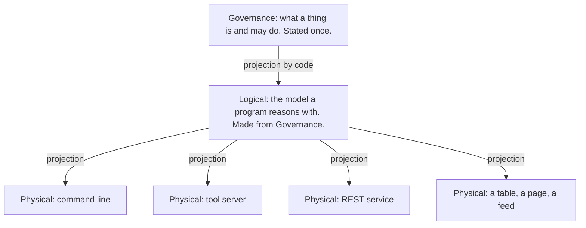

# Kanon in one page

Kanon is a pattern for a library that **states a rule once and carries it into several implementations**, and a small program that checks the pattern was followed. This page is the whole idea. The pages after it take each part in turn.

## Three layers

A library built in Kanon has three layers, in this order from the top.

| Layer | Rank | What it holds | Its viewpoint |
| --- | --- | --- | --- |
| **Governance** | 1 | What a thing is and what it may do, stated once, in the words of its domain: the actions, their effects, their audience, their confirmations. | the computation-independent model |
| **Logical** | 2 | The model a program reasons with, made from Governance by code. | the platform-independent model |
| **Physical** | 3 | What carries the model out in a place: a table, a command, a tool, a route. Where it faces a caller it is called a **surface**. | the platform-specific model |

Each folder of the library, called a **unit**, is in exactly one layer. A higher rank may import a lower one, and not the other way round.

## Six rules

The specification states six rules. A library that is Kanon follows all six.

1. **Three layers.** Every unit is in one layer: Governance, Logical or Physical. The library's own checking (its tests and tools) is in none.
2. **Projection, not copying.** When a layer needs what the layer above says, it derives it by code, a function from the elements above to the elements here. It does not restate it by hand.
3. **Identity survives as a trace graph.** Every element of every layer has an id that is stable across builds, and every element below Governance has at least one trace edge to the element it was made from. The edges make a graph with no cycles that runs only downwards, so from any physical element the governance that says why it exists can be found.
4. **Imports run one way, with a check.** A unit imports only units of a layer above its own, and units of its own layer only where its row of the library's table lists them. A surface imports no other surface. A program checks it.
5. **Nothing is silently dropped.** Each annotation that Governance gives an element, such as its effect, its audience or its retention, ends in one of three ways: **expressed** (a lower element enforces it), **carried** (it is passed on as data a program reads at run time) or **unexpressed** (it is named, with a reason, as one that no lower layer enforces yet). An annotation that ends in none of the three is a finding.
6. **Extensions use only public surfaces.** A package that extends the library reaches it only through its published `exports`, never by a relative path or by a path the exports do not name.

## The table

A library declares its layers in its manifest, as data. This is the field `kanon` of `library.ts`: the package name, and a list of units, each with its folder, its layer and, where it needs one, the exact list of other units it may import. The checker reads this table and the library's files, and returns findings. It needs nothing else.

## The check

The check reads the TypeScript of the library, finds every import, and reports each one that breaks the table: a file in no unit, a file of another unit imported by a relative path, a path the exports do not name, an import that climbs to a layer above, an import across to a unit it may not reach. Each finding has a **code**, a file, a line and one sentence. A finding can be held by a baseline that may only shrink, so a library can adopt the check without fixing everything on the first day.

## Two shapes beyond one library

- **Instances.** A library that carries out one rule in several places of one kind, such as a data library with a dialect for each database, declares each one as an **instance** of a unit, and the check of rule 5 is made for each instance. The result is a **matrix** of requirement by instance.
- **Families.** A **host** is a library that is Kanon and is extended by packages of its own: **plugins**, which add a noun to the host's one program, and **dialects**, which are instances placed in packages of their own. The host together with its extensions is a **family**, and the naming rule of the packages is data of the host's table.

## The vocabulary, in one table

| Term | Meaning |
| --- | --- |
| Unit | a folder of a library that is in one layer |
| Element | one thing a layer says (a concept, an action, a table, a command), with a stable id |
| Projection | the derivation of the elements of one layer from the layer above |
| Trace edge | the record that one element was made from another |
| Surface | a physical unit that faces a caller |
| Finding | a sentence about a breach of a rule, with a code, a file and a line |
| Table | a library's list of units, as data |
| Instance | one of several occurrences of a kind of unit in the Physical layer |
| Host, extension, plugin | a library extended by packages of its own, a package that extends it, and one that adds a noun to its program |
| Family | the host and its extensions, and their naming rule |
| Disposition, matrix | how one annotation ends for one instance, and the table of them |

The [glossary](kanon-glossary.md) has all of them with their sources.

## Where Kanon sits in the larger picture

Mizan's [ladder](mizan-ladder.md) is the rule of a whole harness: a rung relies only on the rungs below it. Kanon applies the same shape inside one library, and adds two things the ladder does not say: projection (rule 2) and identity (rule 3). The two are kept apart. A rung is never a layer, and the ladder's rung numbers and Kanon's layer ranks are not compared.

## What is built

The import check, the trace graph, the check of dropped annotations, the matrix, the family rules and the bundle of a published model are built in `@intellectual-frontiers/kanon`. At the time of writing, 58 library manifests in this repository declare a Kanon table, and all 58 pass the check ([evidence](kanon-gains.md)). The specification is a Draft, and the rules above are the ones it states today.

Next: [one rule through three layers](kanon-worked-example.md), with the real code.
