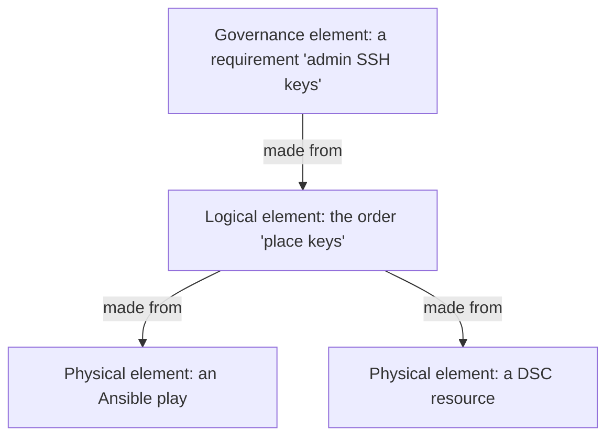

# The trace graph and nothing silently dropped

Rules 3 and 5 of Kanon are about information that a layered design loses by default. When a rule is carried from Governance down to a table, a command and a tool, three things can happen to each of its properties: it is enforced, it is passed along, or it is quietly lost. Kanon makes the third outcome a finding.

## The trace graph: from any physical element, find the reason

Every element of every layer has an id that is stable across builds. Every element of the Logical and Physical layers has at least one **trace edge** to the element it was made from. Together the edges are a graph, and the graph has two properties that a check can verify: it has no cycles, and its edges run only from a layer to the layer directly below it.



From the DSC resource you can walk upward and arrive at the requirement that says why the resource exists. From the requirement you can walk downward and find every place that carries it out. A change to the requirement shows its blast radius as the set of elements downstream of it.

The code that builds the graph is short, and it shows the rule directly: an edge is **valid** only if both ends exist and the target stands exactly one layer below the source.

*Source: `commons/kanon/src/trace.ts`, lines 16 to 30.*

```ts source=commons/kanon/src/trace.ts#L16-L30
/** The trace graph of a layered model: each element's downstream reach and the edges that are invalid. */
export function traceGraph(model: LayeredModel, byId: ReadonlyMap<ElementId, ModelElement>): TraceGraph {
  const next = new Map<ElementId, ElementId[]>();
  const invalid: TraceEdge[] = [];
  for (const edge of model.trace) {
    const from = byId.get(edge.from);
    const to = byId.get(edge.to);
    if (from === undefined || to === undefined || RANK[to.layer] !== RANK[from.layer] + 1) {
      invalid.push(edge);
      continue;
    }
    const targets = next.get(edge.from) ?? [];
    targets.push(edge.to);
    next.set(edge.from, targets);
  }
```

An edge that fails the test is collected as invalid and reported. The rest are the graph.

## Annotations: the properties that can be lost

Governance gives its elements annotations: what a thing may do (its effect), who it is for (its audience), what must be recorded when it runs (its audit), how long it is kept (its retention). An annotation is a promise that something lower will honour. The trouble is that a lower layer can ignore a promise without any error, because ignoring is the default.

Kanon asks each annotation to **end** in one of three ways, and asks the model to say which:

| Ending | Meaning | What the model must give |
| --- | --- | --- |
| **Expressed** | A lower element enforces it | the id of that element |
| **Carried** | It is passed on as data a program reads at run time | the id of the element that carries it |
| **Unexpressed** | No lower layer enforces it yet | a reason, in words |

An annotation that ends in none of the three is `kanon/dropped`. So is one that names a target which is not an element of the model, one that names the element of a different instance, and one that is unexpressed with a blank reason.

The ending is data, called a **disposition**, and it is a closed type: each ending has exactly the fields it needs.

*Source: `commons/kanon/src/model.ts`, lines 92 to 95.*

```ts source=commons/kanon/src/model.ts#L92-L95
export type Disposition =
  | (DispositionBase & { readonly outcome: "expressed"; readonly target: ElementId })
  | (DispositionBase & { readonly outcome: "carried"; readonly target: ElementId })
  | (DispositionBase & { readonly outcome: "unexpressed"; readonly reason: string });
```

## The matrix: requirement by instance

Where a library has several instances of one kind of physical unit, such as a dialect for each tool a program drives, the rule is checked for each instance. The result is a table: a row for each annotation of each requirement, and a cell for each instance.

Kanon's own tests use a small host called `fleet`, with two dialects, `ansible` and `dsc`, and one requirement, "admin SSH keys", with two annotations. The dispositions of the fixture are data:

*Source: `commons/kanon/suite/fixtures/fleet.ts`, lines 129 to 134.*

```ts source=commons/kanon/suite/fixtures/fleet.ts#L129-L134
export const DISPOSITIONS: readonly Disposition[] = [
  { element: SSH_KEYS, annotation: "effect", outcome: "expressed", target: PLAY, instance: ANSIBLE_NAME },
  { element: SSH_KEYS, annotation: "effect", outcome: "expressed", target: DSC_RESOURCE, instance: DSC_NAME },
  { element: SSH_KEYS, annotation: "audit", outcome: "carried", target: PLAY, instance: ANSIBLE_NAME },
  { element: SSH_KEYS, annotation: "audit", outcome: "unexpressed", reason: "DSC has no audit trail for a file resource", instance: DSC_NAME },
];
```

The matrix is built from the model and nothing else, and rendered as a Markdown table. This is the real output of the library's `buildMatrix` and `matrixMarkdown` over that model:

```text output="buildMatrix and matrixMarkdown over the fleet fixture of commons/kanon (a throwaway script run in commons/kanon); 2026-11-24"
| Requirement | Annotation | ansible | dsc |
| --- | --- | --- | --- |
| Admin SSH keys (governance:ssh-keys) | effect | expressed (ansible:authorized-keys) | expressed (dsc:ssh-keys) |
| Admin SSH keys (governance:ssh-keys) | audit | carried (ansible:authorized-keys) | unexpressed: DSC has no audit trail for a file resource |

2 expressed, 1 carried, 1 unexpressed, 0 dropped
```

Read it as an accounting. The effect of the requirement is enforced in both dialects. The audit annotation is carried by Ansible, as data its play holds. In DSC it is unexpressed, and the reason is written down: DSC has no audit trail for a file resource. Nothing is hidden. A reader who wants to know whether DSC records changes to SSH keys has the answer in one cell.

## What a dropped annotation looks like

Remove the DSC disposition for the audit annotation, and the matrix has a cell with no ending. This is what the check reports, from the same library, with that one disposition removed:

```text output="droppedFindings over the fleet fixture with the dsc audit disposition removed (a throwaway script run in commons/kanon); 2026-11-24"
kanon/dropped | governance:ssh-keys has the annotation audit for the instance dsc, and no lower element expresses it or carries it, and nothing names it as unexpressed | kanon/dropped src/governance/keys.ts governance:ssh-keys audit @dsc
```

The finding names the element, the annotation and the instance. The last part is its **key**, which a baseline can hold. The matrix and the check read the dispositions the same way, so the two cannot disagree: a dropped cell in the matrix is exactly a `kanon/dropped` finding, and a test proves it for any set of dispositions.

## Why this matters

A Kanon library that serves several implementations has, by construction, the problem that each implementation may do less than the statement promises. The matrix turns "does every dialect honour the audit requirement?" from a review question into a table.

- **For a person reviewing a change:** the matrix shows the dispositions that changed.
- **For an agent adding an instance:** the matrix lists every annotation the new instance has to account for, and the check refuses a new instance that leaves a gap.
- **For an auditor:** an unexpressed cell carries the reason, so a known limit is a recorded decision and not a surprise.

## Limits

- **The matrix says what the model says.** If a disposition claims that a play carries the audit annotation and the play does not, the check of dispositions cannot see it. A test against the real output of the instance can, and the content method uses exactly such tests ([content and renditions](kanon-content.md)).
- **"Unexpressed" is an allowed answer.** It is honest, and it can become a place to park work. [The page on weaknesses](kanon-weaknesses.md) says how to keep it from becoming one.

Next: [imports run one way](kanon-imports.md).
