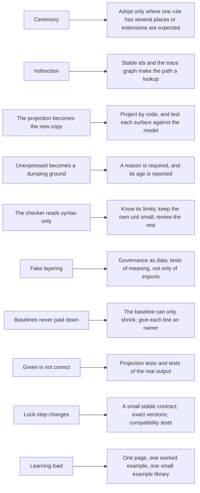

# Weaknesses, and how to avoid them while keeping the strengths

A pattern is worth adopting when you know how it fails. This page lists the weaknesses of Kanon plainly. For each it gives the **symptom** you would see, **why** it happens, the **guardrail** that keeps the strength and avoids the weakness (a check Kanon already has, or a practice a team adopts), and **when it is the wrong tool**.

## 1. Ceremony for a library that does not need it

**Symptom.** Three layers, a table, a manifest field and a check for a library with one implementation and no extensions. The structure is larger than the problem.

**Why.** The pattern pays where one rule is carried into several places or where a library expects extensions. With neither, the layers are labels on folders.

**Guardrail.** Adopt Kanon only where there are **several projections or extension boundaries**. A library with one surface and no growth can be built with plain modules and a good test. Revisit when a second surface appears.

**Wrong tool when.** The library is small, short-lived, or has one implementation and will not gain another.

## 2. Indirection and readability

**Symptom.** To find out why a tool is marked destructive you read a tool descriptor, then a function, then a model, then a statement. A reader who wants the answer feels they were sent on a trip.

**Why.** Projection puts a function between a fact and its use. That is the point, and it is also a cost.

**Guardrail.** Stable element ids and the trace graph make the path a **lookup**, not a hunt: from a physical element, the graph gives the governance that explains it. Keep each projection small and named for what it derives. Write the first line of each Governance entry in the words of the domain, so the statement is readable without the code around it.

**Wrong tool when.** The derivations are so trivial that a reader would rather see the value in place.

## 3. The projection becomes the new copy

**Symptom.** A function that is supposed to derive a surface from the model contains a table of values written by hand. It looks like a projection and it is a copy.

**Why.** A projection that restates the rule by hand puts the drift back, and it hides it behind a function name.

**Guardrail.** Rule 2: derive by code, never restate. Write a **projection test** for every surface that compares its output with the model, as Headless does for its tool hints and REST methods. In review, look for literals in a projection that could have come from the model.

**Wrong tool when.** The team will not write the comparison tests. Without them the structure is decoration.

## 4. "Unexpressed" becomes a dumping ground

**Symptom.** Annotations pile up in the matrix as unexpressed, each with a reason such as "not yet". Nobody returns to them.

**Why.** Unexpressed is an honest answer, and an honest answer is also the easiest one to give.

**Guardrail.** The check requires a **reason**, and a blank one is `kanon/dropped`. Make the reason specific, and treat the matrix as a list of known limits with owners. Report the count of unexpressed cells per release and their age, and treat a count that only grows as a finding of its own.

**Wrong tool when.** Nobody owns the matrix. An unread table is a place to hide things.

## 5. The checker reads syntax only

**Symptom.** An import whose target is computed at run time passes the check. A file placed in the library's own checking unit may import any other file by a relative path.

**Why.** The check parses TypeScript and reads imports it can see. It does not run the code, and a computed target has no literal to read. The library's own unit exists so that tests and tools can reach everything, and that exemption is a hole if production code is put there.

**Guardrail.** Know the limits and write them in the library's notes. Keep the own unit small and limited to tests and tools. In review, reject a computed import in production code. Prefer typed data to configuration files in other formats, because the check reads `.ts` files only.

**Wrong tool when.** The code is mostly dynamic loading. The boundary cannot be checked from syntax.

## 6. Fake layering and leakage of meaning

**Symptom.** The folders are right and the imports are right, and a Logical function still decides something that Governance should say, or a surface carries a business rule.

**Why.** The import check sees the direction of dependencies, not the meaning of the code. A rule can leak without an import.

**Guardrail.** Keep Governance as **data modules** that import nothing of the library, so a rule has one place to live. Review a change to a lower layer by asking what it decides. Add tests that fail when a surface behaves differently from what the model says.

**Wrong tool when.** The domain has no stable statement of what a thing is and may do, so there is nothing for Governance to hold.

## 7. Baselines that are never paid down

**Symptom.** A library adopts the check late, writes a baseline, and the baseline stays the same size for months.

**Why.** A baseline makes adoption possible, and it also makes ignoring possible.

**Guardrail.** The check fails on a finding that is **new** and on a baseline line that **does not occur**, so the baseline can only shrink. Give each line an owner and a target. Report the size of baselines by library. Never add a line to make a check pass; the baseline's own header says so.

**Wrong tool when.** The team treats the baseline as a place to put findings it does not want to see.

## 8. Green checks prove structure, not correctness

**Symptom.** Every check passes and the surface is wrong: a tool is marked read-only that changes data.

**Why.** The import check proves that the layers are kept apart. The matrix proves that each annotation is accounted for. Neither proves that a claim in the model is true of the code.

**Guardrail.** Write tests that compare each surface with the model and, where a model describes a published output, tests against the **real output** (the content library observes the output of each rendition for this reason). Treat a disposition of "expressed" as a claim that needs a test.

**Wrong tool when.** Structure checks are being used as a substitute for tests of behaviour.

## 9. Lock-step changes across layers and packages

**Symptom.** A change to a statement in Governance ripples through the model and every surface. A change to a host's exports breaks every extension.

**Why.** Derivation is a dependency. Where one fact drives many places, a change to it reaches all of them, which is the benefit, and the cost.

**Guardrail.** Keep the host's public exports **small and stable**, since they are the contract. Pin exact versions between a host and its extensions. Put compatibility tests where an extension is built against the host. Use the trace graph to see the blast radius of a change before making it.

**Wrong tool when.** The statement changes daily and has many dependents. Stabilize it first.

## 10. Vocabulary and learning load

**Symptom.** New contributors meet layer, unit, element, projection, trace edge, surface, instance, host, plugin, family, disposition and matrix in their first week.

**Why.** The pattern has real concepts, and each needs a name.

**Guardrail.** Teach in order: the [one page](kanon-one-page.md), then the [worked example](kanon-worked-example.md), then the [small example library](kanon-adopting.md). Most contributors need only the three layers and the import table. Instances, families and the matrix matter to the authors of hosts.

**Wrong tool when.** A team has no time to learn anything and is not willing to let a check teach it.

## 11. Coupling to typed TypeScript

**Symptom.** The check cannot see a Governance statement kept in a spreadsheet or a YAML file.

**Why.** The check reads TypeScript, and the specification asks that Governance be typed data modules so that the check can see it. A library written in another language, or with its rules in files other than TypeScript, gets less from it.

**Guardrail.** Where data is kept in another format, read it through a typed module of the Governance unit so that the check sees the import. For a library in another language, the pattern still applies as a design, and its checker does not.

**Wrong tool when.** The codebase is not TypeScript and the team wants the automated check.

## 12. Premature adoption and a Draft specification

**Symptom.** A team adopts the pattern before it knows its own domain, and the layers harden around the wrong statements. Or the pattern changes under a team that adopted it.

**Why.** Early in a library's life, what is Governance and what is Logical is a guess. And the specification of Kanon is a Draft, so details can change.

**Guardrail.** Start with the import check and one real projection. Add instances, families and the matrix when there is a second implementation. Read the specification's open questions, and treat the table in the manifest as the contract that is checked today.

**Wrong tool when.** The domain is still being discovered.

## Keeping the strengths

The weaknesses above have a pattern of their own. Most of them come from **treating a structural check as if it proved more than it does**. The strengths come from using the structure for what it is good at: one place for a rule, a boundary a machine can enforce, an account of what each implementation honours, and a core that stays small. Keep those four, put tests where the check cannot reach, and keep the baseline shrinking.

Next: [the decision guide and FAQ](kanon-decision-guide.md).
