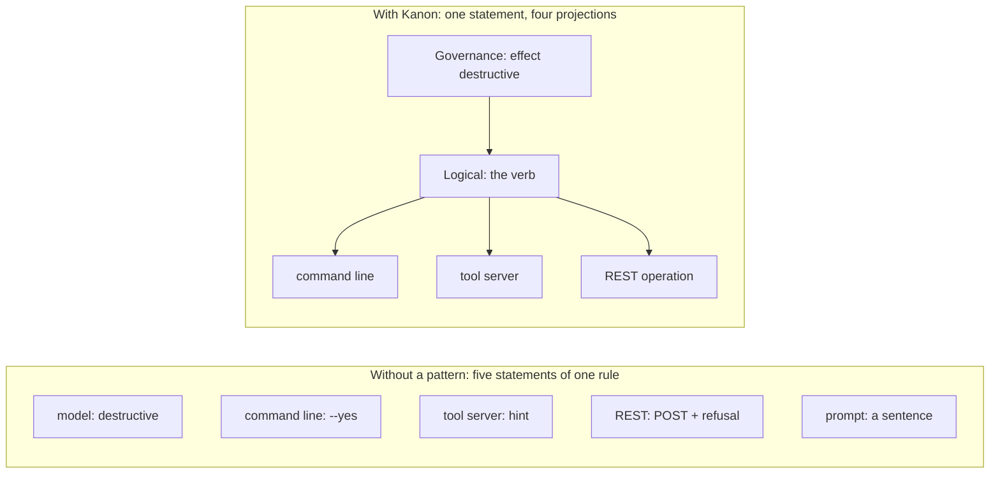

# Why Kanon exists

Kanon exists for two reasons, and both come from the same observation: **a system that is built by many hands, human and machine, stays coherent only if the structure itself pushes back on the hands that would break it.**

1. **Guardrails for AI agents, and a lower chance of drift.** A rule that is written down in one place and carried into every other place by code cannot quietly diverge, and an agent that works inside a few checked constraints stays on task. The constraints are cheap for a machine to check and cheap for a machine to obey.
2. **A good pattern for medium and high complexity libraries.** A library that must allow extensions and plugins is better built as a tiny core that states the rules once and many small packages that extend it only through its public surface, than as one large body of code that every contributor can reach into.

The rest of this group of pages explains what Kanon is, how it works, what it gives the people and agents who adopt it, and what it costs. This page explains why the pattern is a good strategy in the era in which agents write a large share of the code.

*Status of what this page describes: the pattern is specified in [0033-kanon](../../spec-kit/specs/0033-kanon/spec.md), which is still a Draft. The checker, the trace graph, the matrix of dropped annotations and the family rules are built and run in the library `@intellectual-frontiers/kanon`. The pages say which is which.*

## One rule, five places

Take one rule of a command-line program: **a command that destroys data needs an explicit confirmation, and a caller that is a machine must be told so before it tries.** Without a pattern, the rule is written again wherever it matters:

| Where the rule lives | How it is restated |
| --- | --- |
| The model of the program | a field on the command, `destructive: true` |
| The command line | a `--yes` flag, a prompt, a line in the help |
| The tool server an agent connects to | an annotation, `destructiveHint`, so the client can warn |
| The web interface | a `POST` and not a `GET`, and a refusal when the confirmation is missing |
| The instructions given to an agent | a sentence in a prompt: "never run the wipe command without asking" |

Five places say one thing. Each is written by someone, at a different time, often with the other four out of sight. Nothing in the five places says that they belong together, so nothing notices when one of them changes.

In the right-hand picture the rule is stated once, in Governance. Everything else is **derived by code**: a function from the statement to the verb, a function from the verb to the command-line help, to the tool descriptor and to the REST operation. The [next pages](kanon-one-page.md) show how, and [the worked example](kanon-worked-example.md) shows the real code of Headless doing exactly this.

## Why copies drift

Drift is not carelessness. It is what happens to any two statements of one fact that have different owners and different release times.

- **A change is made where the author is looking.** The author edits the command-line help and does not know that the tool descriptor says the same thing. The two now disagree, and both are plausible.
- **Nothing connects the copies.** A person can remember that two places belong together. A repository cannot, unless something records it.
- **A disagreement is discovered late.** It shows up as a bug in the place nobody changed, usually when someone relies on it.
- **Each repair adds a copy.** The usual fix is to correct the second place by hand, which leaves two places that must be kept equal for ever.

Specifications, ontologies and tests reduce this. They do not remove it, because they are themselves more copies unless the code is derived from them.

## Why agents change the arithmetic

Agents do not cause drift, but they change how fast it spreads and how it is shaped. The reasons below are reasoning from how agents work, not measurements from this repository, and they are labelled as such.

- **An agent works with a window, not with the whole system.** It sees the files it reads. A fact stated in five places is, to an agent that read two of them, a fact stated in two places. Expectation, not a measurement.
- **An agent follows the patterns it sees.** Where it finds a restated rule, it tends to restate it again in the next place it writes. A repository with many copies teaches the next change to make another copy. Expectation.
- **An agent is fast.** A human drifts at the speed of a human. An agent that is not constrained can produce a plausible, wrong, locally consistent change in minutes, and many of them in parallel. Expectation.
- **An agent follows instructions it is given, and no more.** A sentence in a prompt is a request. It is not a boundary, and it cannot be checked by a machine the way an import can. Fact about prompts, as opposed to code.

What helps an agent is what helps any worker with limited context: **a small number of clear constraints, each checkable, each reported with the place and the reason when broken.** Kanon is such a set of constraints.

## What a constraint does for an agent

Kanon's constraints are written to be checked by a program, which makes them guardrails and not guidelines.

| Constraint | What an agent that breaks it receives |
| --- | --- |
| A file belongs to exactly one layer | `layers/unclassified`: the file, and the unit it should be in |
| Imports run one way | `layers/above`, `layers/around`, `layers/relative` or `layers/private`, with the line and the import |
| A lower layer is derived, never restated | a trace edge that does not exist, found by the trace check |
| Nothing is silently dropped | `kanon/dropped`, naming the annotation and the instance that lost it |

[The page on imports](kanon-imports.md) prints the real findings. Each finding has a code, a file, a line and one sentence. An agent can read it, change one import, and run the check again in under a second: the check of a library of Headless's size takes about half a second.

Three properties make this suit agents in particular:

- **The constraint is local.** The agent need not understand the system. It needs to know which layer a file is in and what that layer may import.
- **The feedback is immediate and specific.** The finding names the file and the line.
- **The constraint is the same for every agent and every person.** The structure does not depend on the quality of the instructions in a prompt.

## The second reason: a tiny core and many extensions

The first reason is about keeping what is stated once. The second is about what to do when a library grows.

A library that supports many databases, many storage backends or many tools tends to grow in one of two ways. Either it becomes one large package that every backend lives in, and every change anywhere can touch everything, or it becomes many unrelated packages that each restate the core. Kanon names a third shape:

- **A tiny core** that holds the three layers: what the thing is, the model a program reasons with, and the interface that extensions must meet.
- **Extensions**, each a package of its own, that reach the core only through its public exports and never the reverse.

AnyFS is the clearest example in this repository. The host package states what a store, a place and a revision are. Thirteen extensions, each a package of its own in its own folder, supply the backends and tools: S3, SSH, Git, OneDrive, Google Drive, POSIX, SQL and more. Desired OS State does the same for convergence, with a dialect for each tool it drives. [The page on families](kanon-families.md) shows the real manifests.

This shape suits agents for the reason the first section gives. An agent asked to add a backend works in one small package, against one small contract, with a check that tells it if it reached past the contract. It does not need to understand the other twelve.

## What it costs

Kanon is not free, and a pattern with no costs would be a bad sign.

- A library built this way has three layers and a table, which is more structure than a small library needs.
- Following a rule from a command back to its statement is an indirection.
- A projection function that restates the rule by hand puts the copy back.
- The checker reads syntax, so it has limits.

[The page on weaknesses](kanon-weaknesses.md) takes each in turn, with the guardrail that keeps the strength and avoids the cost. [The decision guide](kanon-decision-guide.md) says when not to use Kanon at all.

## Where to go next

- If you are deciding whether to adopt the pattern, go to [What consumers gain](kanon-gains.md), which starts with a one-page brief, then [Weaknesses](kanon-weaknesses.md).
- If you want to see it work, go to [One rule through three layers](kanon-worked-example.md).
- If you want to build with it, go to [Adopting Kanon in a library](kanon-adopting.md).
