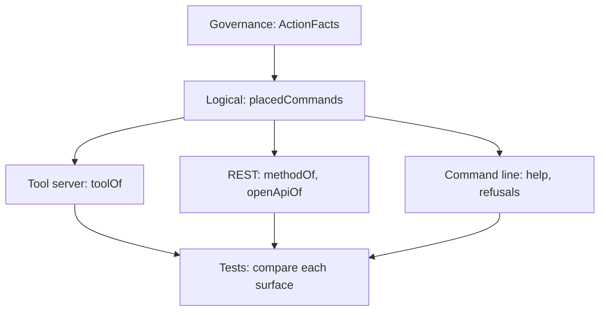

# One rule through three layers

This page follows one rule through the real code of Headless, the library of commons that holds the contract of a program with no window: a command line, a tool server for agents and a REST service, all made from one description of what each command is and what it may do.

The rule is the one from [the first page](kanon-why.md): **a command that only reads, a command that changes something and a command that destroys something are different, and every surface must say so.** Every code block below is quoted from the file named in the line above it, and a test of the documentation fails if a quoted block does not match its file.

The path of the rule through the library is this:



## Governance: the rule is stated once

Governance states what an action is and what it may do. Headless's governance unit holds the type of the facts of an action.

*Source: `commons/headless/src/governance/action.ts`, lines 36 to 53.*

```ts source=commons/headless/src/governance/action.ts#L36-L53
export type ActionFacts = {
  /** Its words as a person types them (`work build`): lower-case words joined by spaces. */
  readonly id: string;
  readonly summary: string;
  readonly kind: Kind;
  readonly effect: Effect;
  /** Whether running it again with the same input changes nothing more. */
  readonly idempotent: boolean;
  readonly audience: Audience;
  /** The tier a caller must hold to see and run it (0010-audience-tiers): the lowest tier of the program's ladder unless it says otherwise. */
  readonly tier: TierName;
  /** Whether `--dry-run` previews what it would change and changes nothing. */
  readonly dryRun: boolean;
  /** Whether `--check` ends with findings where it would change something (a drift check), changing nothing. */
  readonly check: boolean;
  /** The options (by their keys) that only a person may give: a machine surface refuses them. */
  readonly humanOnly: readonly string[];
};
```

An action says what it does to the world (`effect`), whether it is safe to repeat (`idempotent`), who it is for (`audience`), the tier a caller needs, whether it can preview its change, and which options only a person may give. This is the statement. No other file says what `destructive` means.

Defaults are part of the statement. A report reads and is safe to repeat. An action changes something and is not assumed safe to repeat until it says so.

*Source: `commons/headless/src/governance/action.ts`, lines 73 to 86.*

```ts source=commons/headless/src/governance/action.ts#L73-L86
export function defineAction(d: ActionDefinition): ActionFacts {
  return {
    id: d.id,
    summary: d.summary,
    kind: d.kind,
    effect: d.effect ?? (d.kind === "report" ? "read" : "mutate"),
    idempotent: d.idempotent ?? d.kind === "report",
    audience: d.audience ?? "both",
    tier: d.tier ?? PUBLIC,
    dryRun: d.dryRun ?? false,
    check: d.check ?? false,
    humanOnly: d.humanOnly ?? [],
  };
}
```

## Logical: the model a program reasons with

The Logical layer makes the model from Governance. A command in the program's tree carries its facts, and the facts are made by `defineAction`, which is Governance's function. Logical does not restate them.

*Source: `commons/headless/src/logical/model.ts`, lines 181 to 192.*

```ts source=commons/headless/src/logical/model.ts#L181-L192
/** A command together with the path of its words. */
export type Placed = { readonly path: readonly string[]; readonly id: string; readonly command: Command; readonly facts: ActionFacts; readonly reach: ReachPolicy | undefined };

/** The commands of a tree, each with its path and the facts of its action (its id is its words below the program, joined by spaces). */
export function placedCommands(children: readonly Node[], path: readonly string[] = []): readonly Placed[] {
  return children.flatMap((n): readonly Placed[] => {
    const here = [...path, n.name];
    if (n.kind === "branch") return placedCommands(n.children, here);
    const id = here.join(" ");
    return [{ path: here, id, command: n, facts: defineAction({ ...n.action, id, summary: n.summary }), reach: n.action.reach }];
  });
}
```

`placedCommands` walks the tree of a program and gives each command with its path and **the facts of its action**, made by `defineAction` from the action the command declares. The command's id is derived from its words. The model is derived, not written.

## Physical: three surfaces, each a projection

Three surfaces face three kinds of caller. Each imports Logical and Governance and no other surface, and each makes its output from the facts.

### The tool server

An agent connects to a tool server and asks what it may call. The descriptor of each tool is made from the facts of the command.

*Source: `commons/headless/src/surfaces/mcp/tools.ts`, lines 47 to 66.*

```ts source=commons/headless/src/surfaces/mcp/tools.ts#L47-L66
/** The tool of one command. */
export function toolOf(program: string, p: Placed): McpTool {
  const properties: Record<string, ArgSchema> = {};
  const required: string[] = [];
  for (const [key, o] of Object.entries(offeredOptions(p))) {
    properties[key] = schemaOfOption(o);
    if (o.kind === "value" && o.fallback.kind === "required") required.push(key);
  }
  for (const operand of p.command.operands) {
    properties[operand.name] = operand.arity === "many" ? { type: "array", items: { type: "string" }, description: operand.help } : { type: "string", description: operand.help };
    if (operand.arity === "one" || operand.arity === "many") required.push(operand.name);
  }
  return {
    name: toolName(program, p.path),
    title: `${program} ${p.id}`,
    description: `${p.command.summary} (${p.facts.kind}, effect ${p.facts.effect}${p.facts.idempotent ? ", safe to repeat" : ""}.)`,
    inputSchema: { type: "object", properties, required, additionalProperties: false },
    annotations: { readOnlyHint: p.facts.effect === "read", destructiveHint: p.facts.effect === "destructive", idempotentHint: p.facts.idempotent, openWorldHint: false },
  };
}
```

The three annotations at the end are the rule, projected. `readOnlyHint` is true exactly when the effect is `read`. `destructiveHint` is true exactly when the effect is `destructive`. `idempotentHint` is the fact itself. No one writes these three booleans for a tool. The same function writes them for every tool.

### The REST service

The OpenAPI document makes a path and a method for each command the caller's tier may see. The method is a projection of the effect.

*Source: `commons/headless/src/surfaces/rest/openapi.ts`, lines 40 to 43.*

```ts source=commons/headless/src/surfaces/rest/openapi.ts#L40-L43
/** The method of an operation: `GET` where the command only reads, `POST` where it changes something. */
export function methodOf(p: Placed): "get" | "post" {
  return p.facts.effect === "read" ? "get" : "post";
}
```

A command that only reads is a `GET`. A command that changes something is a `POST`. A web client cannot get this wrong by hand, because there is no hand involved.

### The command line

The command line makes its help, its flags and its refusals from the same facts. A destructive command asks for a confirmation, and a machine caller that did not give one is refused by the same rule that the tool server and the REST service apply, with the same set of reasons.

## The tests compare the projections

A projection is only as good as the test that compares it with its source. Headless's tests build a program with a read, a change and a wipe, and check that each surface says the same thing about each.

*Source: `commons/headless/suite/mcp-rest.test.ts`, lines 87 to 88.*

```ts source=commons/headless/suite/mcp-rest.test.ts#L87-L88
  assertEquals(byName("desired_os_state_server_list")?.annotations, { readOnlyHint: true, destructiveHint: false, idempotentHint: true, openWorldHint: false });
  assertEquals([byName("desired_os_state_server_wipe")?.annotations.destructiveHint, byName("desired_os_state_server_wipe")?.annotations.readOnlyHint], [true, false]);
```

The tool of the read command is read-only, and the tool of the wipe is destructive and not read-only. The same program's OpenAPI document makes the matching claim:

*Source: `commons/headless/suite/mcp-rest.test.ts`, lines 203 to 205.*

```ts source=commons/headless/suite/mcp-rest.test.ts#L203-L205
  const list = pub.paths["/v1/server/list"]?.["get"];
  assertEquals([list?.operationId, list?.["x-effect"], list?.["x-tier"]], ["desired_os_state_server_list", "read", "public"]);
  assertEquals(list?.parameters?.map((p) => [p.name, p.in, p.required]), [["limit", "query", false], ["all", "query", false], ["name", "query", false]]);
```

The read command is found under `get`, its operation is named from the program and its words, and its effect is `read`. Two surfaces, one fact, checked from both sides against the same model.

## The table that keeps the layers apart

All of this stays separate because Headless declares its layers as data, and a checker holds them. The start of Headless's table:

*Source: `commons/headless/library.ts`, lines 20 to 39.*

```ts source=commons/headless/library.ts#L20-L39
    units: [
      { folder: "src/governance/", layer: "governance", packages: [{ name: "@intellectual-frontiers/core", subpaths: [] }] },
      {
        folder: "src/logical/",
        layer: "logical",
        packages: [
          { name: "@intellectual-frontiers/core", subpaths: [] },
          { name: "@intellectual-frontiers/terminal", subpaths: ["args", "commands"] },
        ],
      },
      {
        folder: "src/surfaces/cli/",
        layer: "physical",
        mayImport: ["src/governance/", "src/logical/"],
        packages: [
          { name: "@intellectual-frontiers/core", subpaths: [] },
          { name: "@intellectual-frontiers/terminal", subpaths: "any" },
          { name: "@intellectual-frontiers/system", subpaths: "any" },
        ],
      },
```

Governance may import only the kernel package. Logical may import Governance and the terminal's command types. The command-line surface may import Governance and Logical, and the table lists the external packages it may use. The other surfaces have rows of their own. A surface that tried to import the tool server from the command line would be a finding.

The check is run by the library's own `verify` script. Run from Headless's folder, it prints:

```text output="bun ../kanon/src/check.ts (in commons/headless); 2026-11-24"
kanon-check: passed: 0 new, 0 stale, 0 held by kanon.baseline.txt
kanon-check: import result ok
```

It took 0.48 seconds on the day it was run.

## What this buys

- **One place to change a rule.** Change what `destructive` implies in Governance, and every surface that projects it changes. A surface that would have to be edited by hand fails its test instead.
- **One place to look.** To find why a tool is marked destructive, follow the projection to the fact in Governance.
- **A boundary an agent can obey.** A change to the REST surface cannot reach into the command line, because the table does not list it, and the check says so with the line.

## What it does not do

The projection only holds the rule if the projection function is honest. If someone writes a surface by hand and sets `destructiveHint: true` on a tool for a different reason, the check of imports does not notice. The tests that compare surfaces with the model are what catch that, and they have to be written. [The page on weaknesses](kanon-weaknesses.md) takes this up.

Next: [the trace graph and the matrix of dropped annotations](kanon-trace-and-dropped.md).
