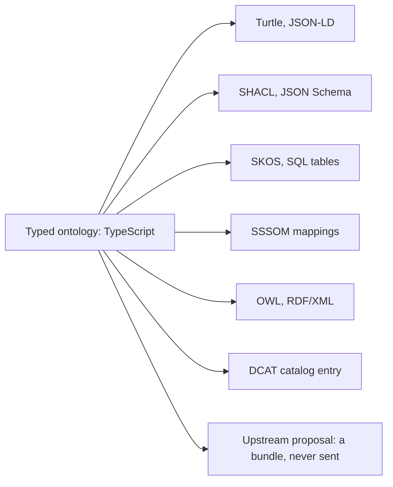

# IFC Mizan Integrations

The module of Mizan extensions and plugins at `commons/mizan/src/integrations/`. It does two jobs: bring outside ontologies into our typed TypeScript form, and turn ours into well-known, reusable ontologies. **Spec: Draft** `0019-mizan-integrations`; **Built**.


Losses (blank nodes, lists, restrictions) are reported as findings, never dropped. Provenance is recorded in PROV-O.



Each export is read by an independent tool in a test: an RDF parser, a SHACL validator, a JSON Schema validator.

## Import: only when necessary

1. An import is made only where a term or schema a specification uses is not already available, and it names the **slice** it needs, never a whole standard.
2. It refuses a source whose SHA-256 or license differs from its `Standard` record.
3. It writes a generated `.auto.ts` module whose header names the source, version, hash, license and generator; its terms have the basis `adopts`.
4. What the typed form cannot hold is a **finding**, never a silent drop.
5. The written graph, in canonical N-Triples, must equal the source's graph for the slice (the round trip).
6. An `ImportRecord` keeps the provenance in PROV-O: what, from where, when, by which generator, with which hash.

**There is a precedent.** An engine of ours vendors FedRAMP's machine-readable rules under a pinned commit and SHA-256 and generates TypeScript from them, and does the same for OCSF. The integrations module generalizes that pattern, and re-importing what we already use (schema.org, PROV-O, DPV, OSCAL, OCSF) turns hand-written copies into generated ones.

## Export: to well-known forms

Turtle, N-Triples, N-Quads and JSON-LD already come from the kernel. The module adds SHACL shapes and JSON Schema (from class schemas), SKOS concept schemes and SQL code-list tables (from code lists), SSSOM mapping files (from terms whose basis is `maps`), and later OWL, RDF/XML and a DCAT catalog entry for each published ontology. We use SSSOM and DCAT rather than invent a mapping or catalog format, which is the standards-first rule applied to our own tooling.

**Never published without a person.** Where one of our terms could improve a standard (schema.org, SPDX), the module prepares a proposal bundle. It sends nothing.

## The plugin model **Built (rules); importers and exporters are typed records**

```ts
// Illustrative sketch of the typed integration record.
interface Integration<In, Out> {
  readonly id: string;
  readonly direction: "import" | "export";
  readonly from: Format;
  readonly to: Format;
  readonly standard: StandardRef;
  run(input: In): Result<Out, Finding[]>;  // errors are values, never thrown
}
```

- A registry looks integrations up by their formats; no `any`, no non-null `!`, exhaustive `switch` over every union.
- Mizan's own checks (the EARS rules, the standards rules) are plugins through the same extension point, so a harness can add its own rules without a fork.
- Two layers: `pure/` (functions over text, no effects) and `host/` (fetching, files, pins).
- TypeScript 7 first. Where it cannot do the job and a hand-written parser would not be good enough, the best stack is used through a typed `Exception` ([Two languages](mizan-languages.md)). XML-based formats (RDF/XML, NIEM's XSD) are the likely first case, decided when the first one is needed.

## Candidate first importers

| Source | Why | Status |
| --- | --- | --- |
| OSCAL (NIST); FedRAMP rules | The proof register, controls, federal security | License and current release to verify before import |
| schema.org, PROV-O, SKOS, SHACL, DPV | Already specialized or typed in commons | Re-import so copies become generated |
| SPDX 3, CycloneDX | Packaging and SBOM | To verify |
| FHIR, US Core, USCDI | Healthcare products | Only when a product needs it |
| NIEM | Federal, state and local data exchange | Later, only when needed |
