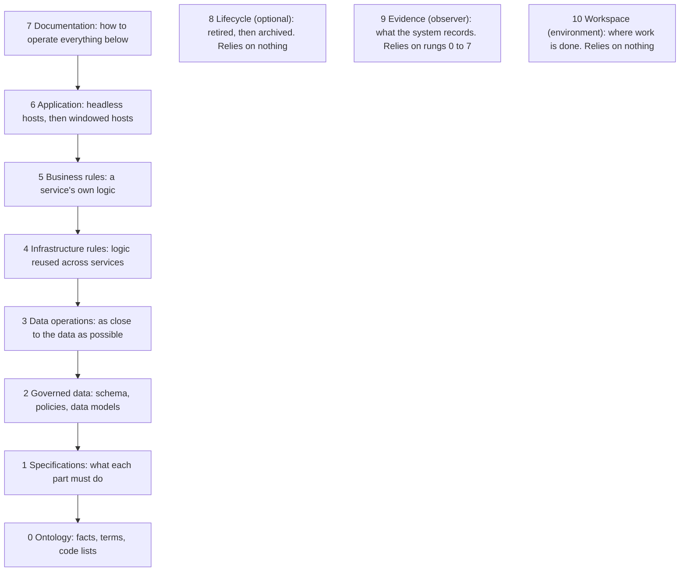

# The ladder

Our harnesses each described a ladder of rungs: a stack of layers, each relying only on those below. Mizan states it **once**, as typed data in commons (`mz:Rung`, with `mz:RungKind`), and each harness states its own homes as an instance of it. The ladder now has **eleven rungs**.

*Rungs 0 to 7 are required of every harness. Rung 8 is optional: what is retired (alive, not to be used), then what is archived (dead, safe to delete). Rung 9, Evidence, is an observer: it records and proves what the other rungs do, and no rung relies on it. Rung 10, Workspace, is an environment: where everything else is built. Both are required of a harness that claims a regulated domain.*

## The four kinds of rung

`mz:RungKind` is a code list, so code branches on a type the ontology owns.

| Kind | Rungs | Meaning |
| --- | --- | --- |
| required | 0 to 7 | Every harness has the rung and builds on the rungs it names. |
| optional | 8 | A harness may have it; it relies on no rung and no rung relies on it. |
| observer | 9 | Records and proves what the other rungs do; required where a regulated domain is claimed; no rung relies on it. |
| environment | 10 | The working environment everything is built in; required where a regulated domain is claimed; it relies on no rung and no rung relies on it. |

## The rules

1. **Dependency direction.** A rung relies only on the rungs below it that it names, and never reaches around the rung under it. An import that climbs, or skips a rung it may not, is refused.
2. **Order of work.** A change is complete only when every rung it touches is updated and proved by that rung's checks, lowest first: the term in the ontology, then the requirement in a specification, then the data, the code and the documentation.
3. **Headless first.** Rungs 0 to 5 are headless; rung 6 holds the headless hosts before the windowed ones; every operation a window offers is also a command or a tool.

## An instance, not a copy

A harness states its ladder as individuals of the commons `Rung` class in its own ontology. It may add homes, checks and rely-on edges; it may not renumber, rename or drop rungs 0 to 7, and a rung it leaves empty says why. Its constitution table and the layout in its `AGENTS.md` are generated from those individuals between marker comments, and the generator's `--check` fails if either differs. Every file belongs to exactly one rung, by the most specific of the rungs' homes.

**Built** the tracing and layer checks (`0015-trace`, in the kernel), and the shared `mz:Rung` and `mz:RungKind` with the eleven rungs as typed individuals (`commons/ontology/mizan/`, `0016-ladder`). **Planned** moving each harness's ladder to an instance.

**The ladder is itself an invention.** No standard names these rungs (ISO/IEC/IEEE 42010 and layered architecture are related, but define none of them). Under our own rule the ladder is therefore `unaligned`, and its justification and Decision are the first entry in the register.
