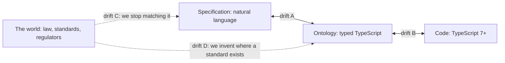

# Why: the drift problem

A company that writes specifications, defines an ontology and builds code keeps its facts in three places. Left alone, the three drift apart, and nobody notices until something breaks, an auditor asks, or an agent builds the wrong thing from the wrong source.

*Four kinds of drift. A: a specification says one thing and the ontology another. B: the ontology and the code disagree. C: the law or a standard moves and we do not. D: we coin our own term where one already existed.*

- **A. Specification and ontology.** A requirement uses a word the ontology never defined, or the ontology's definition changed and the specification still uses the old meaning.
- **B. Ontology and code.** Code branches on a list of words written again by hand, and one list changes without the other.
- **C. Us and the world.** A control, a clause or a schema is revised by NIST, FedRAMP or FDA, and our copy stays at the old version.
- **D. Invention.** We invent a term for something a standard already names. Every invention is a private dialect that an auditor, a partner or an agent must learn.

## Why it matters more for us

Most of what Intellectual Frontiers builds is regulated by United States law: federal security (NIST, FedRAMP), medical-device quality (FDA's QMSR, 21 CFR Part 820) and electronic records (21 CFR Part 11). For regulated work, "we meant the same thing" is not a defence. The words must be the law's words, the evidence must trace to a requirement, and the requirement must trace to its authority. A private vocabulary makes every audit a translation exercise.

And it matters more when agents write code. An agent works from whatever it can read. If the specification, the ontology and the code disagree, the agent will pick one, confidently.

**Honest limit.** Drift can be reduced, not eliminated. A type checker cannot check prose against code. Mizan narrows the gap with typed data, traceable identifiers and deterministic checks, and it states plainly what only a person can judge ([Reducing drift: the controls](mizan-controls.md)).
