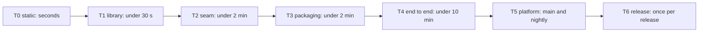
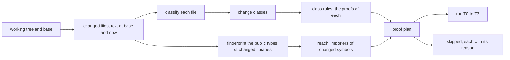
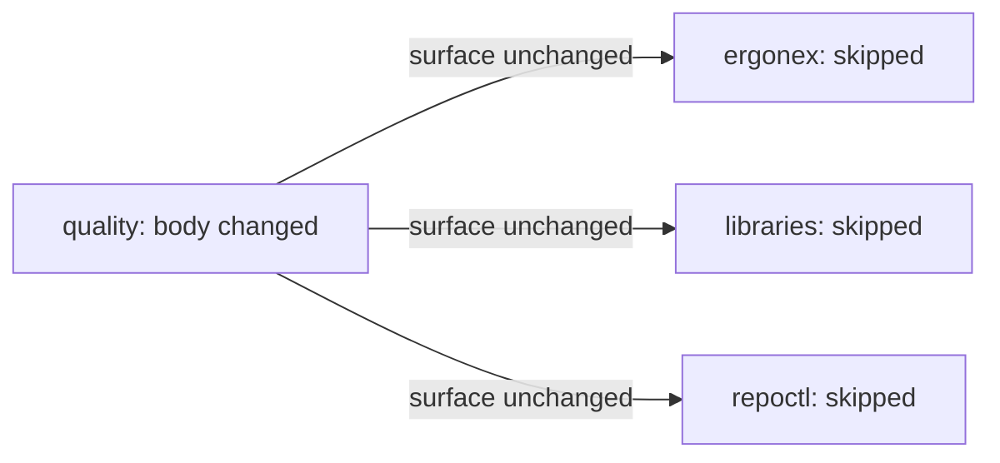
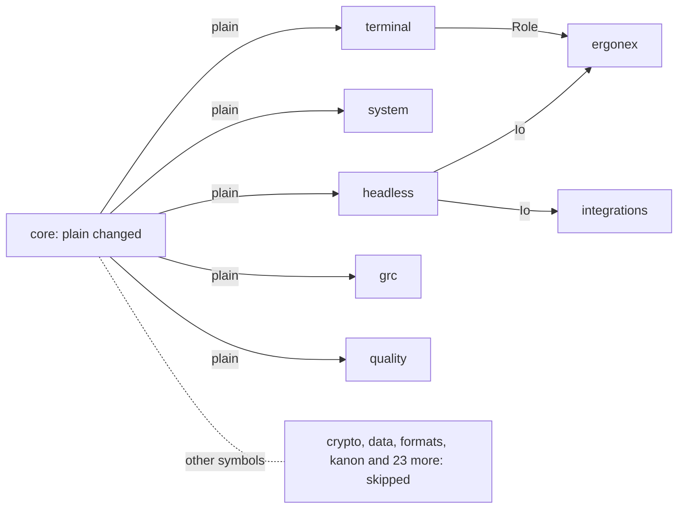
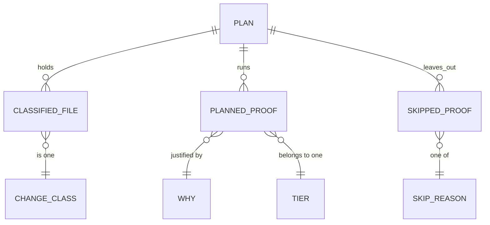

# Proof proportional to blast radius

Running every test after every change costs minutes and teaches nothing when the change can only break a small part of the repository. `repoctl prove` makes the proof as large as the change's blast radius: it works out what a change can reach, runs the proofs that cover that and nothing else, and says why each proof it leaves out is safe to leave out. The same plan drives a local run and the plan job of CI ([commons repoctl 0007-repoctl-prove FR-001](../../repoctl/spec-kit/specs/0007-repoctl-prove/spec.md)).

## The problem

A comment edit in `core` and a changed signature in `core` look alike to a tool that only asks which package changed: both affect the thirty libraries that import it. The first can break nothing. The second can break the few libraries that use the changed symbol, and no one else. Proof that ignores that difference is either too slow (everything runs) or too weak (a guess about what to skip). Here the skip is derived: from the text of the change, from a fingerprint of each library's public types, and from what each library imports by name, and every skip is a recorded fact with a reason.

## The tiers and their budgets

Seven tiers of proof, cheapest first. A proof belongs to exactly one ([commons repoctl 0007-repoctl-prove FR-002](../../repoctl/spec-kit/specs/0007-repoctl-prove/spec.md)).



| Tier | Proves | Budget | Runs on |
| --- | --- | --- | --- |
| T0 static | types, specification and trace checks, `sync --check`, the versions check, the documentation check; the affected files only | 10 s | every edit and push |
| T1 library | the suite of one library, property tests included | 30 s | every edit and push |
| T2 seam | the tests of a consumer that import a symbol a provider changed | 2 min | push, main, nightly |
| T3 packaging | a tarball packed, installed, imported and type-checked | 2 min | when exports, `package.json` or the packer change |
| T4 end to end | the hermetic flows of a product | 10 min | main, nightly, release |
| T5 platform | Windows, macOS, Node against Bun, for libraries with code of their own for a system | 10 min | main, nightly |
| T6 release | everything | 30 min | once per release |

`repoctl prove` runs T0 to T3 where they apply. T4 to T6 are planned and left to CI, the nightly run and the release, because they need other systems or every library.

## From a change to a plan



Each changed file is classified by its path and by its text at the base and now, by a pure function ([`classifyFile`](../../repoctl/src/logical/prove.ts)). The plan is the union of the proofs of the classes of its files.

| The change is | Class | It proves |
| --- | --- | --- |
| a comment, TSDoc or prose; code that differs only in comments or layout | `prose` | the documentation check |
| specification text, requirement identifiers unchanged; a `// Spec:` line | `spec` | the specification and trace checks |
| requirement identifiers added or removed | `spec-requirements` | the specification and trace checks and the suite of the library |
| a file a generator makes | `generated` | `sync --check`: the bytes equal the generators' |
| a version or the release record only | `version` | the versions check |
| a test file | `test` | types, trace and the suite of that library |
| code inside a library | `source` | types, trace and the suite of the library; importers by the next rows |
| a public signature changed | `source` | T0 and T2 for the importers of the changed symbols only |
| a foundation library (`core`, `formats`, `crypto`, `system`, `terminal`, `kanon`, `libraries`) | `source` | the smoke gate: the suites of every foundation library |
| exports, `package.json` beyond its version, the packer | `packaging` | T3: pack, install, import and type-check |
| the planner, the generators, the workflow definitions, the tier rules | `planner` | every proof of every tier |
| a file in no library that is none of these | `outside` | the checks of the repository, the libraries that read it and the end-to-end flows |

A plan never skips what it cannot show safe. A change to the planner, a file Git cannot compare, or `--all` plans every proof of every tier ([commons repoctl 0007-repoctl-prove FR-005](../../repoctl/spec-kit/specs/0007-repoctl-prove/spec.md)).

## Reading a plan

`repoctl prove --why` prints the plan with the reason for every proof. This is a real run for one changed signature in `core` (`plain` took a second parameter):

```sh
$ bun run repoctl prove --why --base origin/main
1 changed file since origin/main; classes: source
T0 static (budget 10s)
  run   trace check of core
          1 file is source: code inside a library
  run   types of core
          1 file is source: code inside a library
  run   types of grc
          the public surface of core changed in plain, which this library imports
  run   types of headless
          the public surface of core changed in plain, which this library imports
  run   types of ergonex
          the public surface of headless changed in Io, which this library imports
T1 library (budget 30s)
  run   smoke gate of core
          core is a foundation library: the smoke gate of the foundation runs before anything wider
  run   suite of core
          1 file is source: code inside a library
T2 seam (budget 120s)
  run   seam core to headless
          the public surface of core changed in plain, which this library imports
  run   seam headless to ergonex
          the public surface of headless changed in Io, which this library imports
  skip  T2 seam core to archon, archon-dialect-apt, archon-dialect-homebrew, archon-dialect-mise and 23 more: these 27 importers import other symbols of core than plain (symbols-unused)
  skip  T3 packaging: no class of this change needs it (source) (class-needs-none)
  skip  T4 end to end: it runs on main, nightly, release, and this change reaches none of what it proves (tier-scheduled)
8 of 33 libraries are proved
```

Read it from the top. The first line says what changed and its classes. Each tier lists the proofs that run, each with the sentence that justifies it. Each `skip` line is a proof that does not run and the reason it is safe, drawn from a closed set:

| Reason | Meaning |
| --- | --- |
| `class-needs-none` | no class of the change needs this tier |
| `surface-unchanged` | the library's public types are the same as at the base, so its importers cannot see the change |
| `symbols-unused` | the importers use other symbols of the library than the ones that changed |
| `tests-unaffected` | a test imports nothing that changed and proves no changed requirement |
| `cache-hit` | the test has the key of a test that passed: same test, same sources, same runtime |
| `tier-scheduled` | the tier runs on main, nightly or at the release |
| `quarantined` | the test is held back by its owner until an expiry day |

`--plan` prints the same plan as one JSON document and runs nothing, which is what CI and other tools read. `--tier N` runs one tier. `--no-cache` runs every selected test.

## The fan-out of a change

The same library, changed two ways, reaches very different sets. A change inside `quality` that leaves its public types as they were has four affected libraries for a tool that reads packages, and one for `prove`:



A changed signature in `core` reaches only the libraries that import the changed symbol, and through their own surfaces the libraries that use what they re-expose:



## How each mechanism is built

1. **Reach by symbol and file, not by package.** The public type surface of a library is fingerprinted: the compiler emits the declarations of the library's entries, comments removed, and the hash of each exported declaration (with the declarations local to its file) is its fingerprint ([`surface.ts`](../../repoctl/src/logical/surface.ts), [commons repoctl 0007-repoctl-prove FR-007](../../repoctl/spec-kit/specs/0007-repoctl-prove/spec.md)). The changed symbols are the names whose hash differs between the base and now. A body change that keeps the declared types has the same fingerprint. Importers are found by reading what each library's sources import, by name, from each library's package ([commons repoctl 0007-repoctl-prove FR-008](../../repoctl/spec-kit/specs/0007-repoctl-prove/spec.md)). Reach is followed through importers whose own declarations mention a changed symbol. Test selection is file-level: a test runs where anything it transitively imports changed, with the requirements named on a `// Spec:` line as a second selector, each requirement naming the tests that prove it ([`select.ts`](../../repoctl/src/logical/select.ts), [FR-011](../../repoctl/spec-kit/specs/0007-repoctl-prove/spec.md)).
2. **A content-addressed result cache.** A passing test is kept under the hash of the runtime, the test and every source it imports, in a folder outside the repository (the cache folder of XDG, or `REPOCTL_CACHE`). An identical key is not run again; a failure is never cached; a test that reads the checkout is never cached nor left out ([`tests.ts`](../../repoctl/src/physical/tests.ts)). A shared cache for CI is not built yet.
3. **Seam tests.** A consumer declares what it uses by importing it. When a provider's surface changes, the tests of a consumer whose library imports a changed symbol run as T2; the others are skipped with `symbols-unused`. Provider conformance suites are the provider's own T1.
4. **A foundation smoke gate.** `core`, `formats`, `crypto`, `system`, `terminal`, `kanon` and `libraries` stand under everything. A change inside one runs the suites of all seven first (about twenty seconds together), and a failure there is seen before any wider proof ([commons repoctl 0007-repoctl-prove FR-012](../../repoctl/spec-kit/specs/0007-repoctl-prove/spec.md)).

The plan itself is a value, a closed vocabulary all the way down:



```ts
import { CLASS_RULES, tierOfProof } from "@intellectual-frontiers/repoctl/governance";
import { planProof } from "@intellectual-frontiers/repoctl/logical";

CLASS_RULES.prose.tiers; // ["T0"]
tierOfProof({ kind: "sync-check" }); // "T0"
// planProof answers with a plan, or with the libraries whose surface it still needs
```

## Guard rails

- A nightly full run and the release gate remain: `ci` runs on a schedule (03:17 UTC) and on dispatch with the plan `--all`, which plans every tier, and the release runs everything once.
- A change to the planner, the generators, the workflow definitions or the tier rules plans everything, always.
- Main keeps its affected set: the plan job of CI writes the proof plan to the summary of its run and gates nothing on it, so what main proves is never less than before ([commons repoctl 0007-repoctl-prove FR-014](../../repoctl/spec-kit/specs/0007-repoctl-prove/spec.md)).
- A failing property test prints its seed and counterexample in the failure.
- A flaky test is quarantined in `commons/repoctl/quarantine.json` with an owner and an expiry day. It is reported by every plan that would have run it, and it runs again when the expiry passes and the run warns ([commons repoctl 0007-repoctl-prove FR-013](../../repoctl/spec-kit/specs/0007-repoctl-prove/spec.md)).

## Add a test to the right tier

- A test of one library's behaviour is `suite/<kebab-case>.test.ts` in that library: T1. Name the requirements it proves with `proves([...])`; that is also what selects it when the requirement's file changes.
- A test that two libraries must agree on is a seam: write it in the consumer, import the provider's symbols you rely on, and it runs as T2 whenever those symbols change.
- A test that packs and installs a tarball is T3 (`tools/pack.ts --check` of a library); a hermetic flow across a product is under `tests/` (T4).
- A test that reads the checkout should name it (`CHECKOUT`): it is then never cached and never left out.

```sh
bun run repoctl prove            # T0 to T3 for what your tree changes
bun run repoctl prove --why      # with the reason for every proof and every skip
bun run repoctl prove --plan     # the plan as JSON, nothing run
bun run repoctl prove --all --plan   # every proof of every tier
```

## Extend a class

A class is one row of the table of class rules and one branch of the classifier, held complete by the compiler. To add one: add its name to the `ChangeClass` union and its row to `CLASS_RULES` in [`proof.ts`](../../repoctl/src/governance/proof.ts), classify its files in `classifyFile`, and plan its proofs in the exhaustive `switch` of `planProof`; the compiler names each place you missed. Add the proofs it needs to the `Proof` union if it has a new kind, and its command to `commandOf`. A change to any of these files is itself a `planner` change, so it is proved by everything.

```ts
// proof.ts: the closed union and its table
export type ChangeClass = "prose" | "spec" | "generated" | "source" | "planner" /* ... */;
export const CLASS_RULES: Readonly<Record<ChangeClass, ClassRule>> = {
  prose: { class: "prose", means: "a comment, TSDoc or text with no code change", proofs: "the documentation check", tiers: ["T0"] },
  // one row for each class: a missing row does not compile
};
```

## Measured

@@MEASURED@@

Related: [the release loop](concept-release-loop.md), [add a library](add-a-library.md), [the contributor path](contributor.md).
