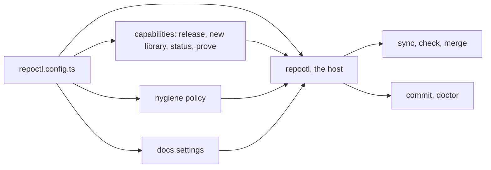

# Repoctl in your repository

`repoctl` is the operations program of commons, and it is not tied to commons. It is a host: it knows no repository, and everything it needs to know of yours is in one typed file at the root, `repoctl.config.ts`. This guide is for the engineer who adds it to a repository of their own: install it, write the configuration, run the verbs every repository has, turn on the ones some repositories have, and read what it says when something is wrong.

## What you get

The host is one command with a fixed set of verbs, and your configuration decides what each of them does in your repository (commons repoctl 0010-repoctl-host FR-001, FR-002).



`check`, `sync`, `merge`, `commit` and `doctor` are in every repository. The release, the scaffold of a library, the status of packages and the proof by blast radius are capabilities that a configuration turns on with a flag; `hygiene` is there where the configuration has a hygiene policy, and the `docs` verbs where it has docs settings.

## Install it

The package is published to npm, with the command `repoctl` and a typed API. It needs Node 26 or Bun, and nothing else: the command is one bundled file.

```sh
npm install --save-dev @intellectual-frontiers/repoctl
npx repoctl doctor
```

`repoctl doctor` runs with no configuration, and it says so: it ends with `E-CONFIG-MISSING`, which `repoctl explain E-CONFIG-MISSING` explains (commons repoctl 0009-repoctl-config FR-002).

## Write the configuration

Three lines make a valid configuration: the name of the repository and the rules of its commits.

```ts
import { defineConfig } from "@intellectual-frontiers/repoctl";

export default defineConfig({
  repo: "acme/app",
  commit: { identity: { name: "A B", email: "a@example.test" }, issue: { prefix: "Refs #", required: false } },
});
```

`defineConfig` checks the shape as you type it. When `repoctl` reads the file it checks the rest, and says every reason at once: an id used twice, a generator that waits for one that does not exist, a capability that needs `libraries`. The host looks for the file in the working folder and above it, up to the root of the Git checkout; `--config FILE` names another (commons repoctl 0009-repoctl-config FR-001, FR-002).

### Generators and checks

A generator is a program that makes files from sources and can check that they are what it makes. Declare each one once, with what it reads and what it writes, and `repoctl sync` runs the stale ones in dependency order, `repoctl check` reports each, and `repoctl merge` makes a conflicted generated file again instead of asking you to resolve it by hand (commons repoctl 0009-repoctl-config FR-003).

```ts
import { defineConfig } from "@intellectual-frontiers/repoctl";

export default defineConfig({
  repo: "acme/app",
  commit: { identity: { name: "A B", email: "a@example.test" } },
  generators: [
    { id: "api-types", command: ["bun", "tools/api-types.ts"], inputs: ["api/**"], outputs: ["src/api.auto.ts"] },
    { id: "readme", command: ["bun", "tools/readme.ts"], inputs: ["src/api.auto.ts"], outputs: ["README.md"], mixed: ["README.md"], after: ["api-types"] },
  ],
  checks: [{ id: "spec", summary: "The specifications agree with the tests.", command: ["./agora", "check"] }],
});
```

The check of a generator is its command with `--check` added: it writes nothing, ends with 0 where its files are what it makes and with 1 where they are not. Give `check` yourself where your program says it another way, or make the generator a typed function in place of a program. A named check is a command whose lines, when it ends with 1, are the findings.

### Commits

`repoctl commit` makes the commit as the identity of the configuration and refuses what must not be committed. The trailers, their order and the issue reference are yours; the line that credits an agent and the address of its session come from `--co-author` and `--session` or from the variables `REPOCTL_CO_AUTHOR` and `CLAUDE_SESSION_URL` (commons repoctl 0009-repoctl-config FR-004).

```ts
commit: {
  identity: { name: "A B", email: "a@example.test" },
  issue: { prefix: "Refs #", required: true },
  trailers: ["issue", "co-author", "session"],
  forbidden: { paths: [{ glob: "**/.claude/**", why: "the local folder of an agent" }], allow: [], secrets: [] },
},
```

Spread `DEFAULT_FORBIDDEN_PATHS` and `DEFAULT_SECRET_PATTERNS` from the package where you want what commons refuses: the local folder of an agent, `node_modules`, environment files, keys and the common tokens.

## Turn on the optional verbs

Each of these is a flag, a setting or a block of the configuration. A verb whose flag is off is not in the help, is not served as a tool and ends with 2 if it is typed (commons repoctl 0010-repoctl-host FR-002).

```ts
capabilities: { status: true, release: true },
libraries: { folder: "libs", linker: ["bun", "tools/link.ts"] },
hygiene: { scope: "@acme/", gitSources: ["acme/platform"], pathSegment: "platform", sourceMarker: "" },
doctor: { minNode: 26, install: "bun install --frozen-lockfile" },
docs: { config: "docs.config.ts", out: "_site" },
```

The release, the new library, the status and the proof read the manifests of a family of libraries in the layout of [libraries](../../libraries/); a repository that is not built that way leaves them off. The hygiene policy says how your repository may consume a family of packages (published, at exact versions, no Git or path dependency); `doctor` checks Git, the installed dependencies, the generated files and what its policy names.

## Build the documentation

`repoctl docs build`, `docs check` and `docs serve` wrap the documentation generator `ifc-docs`. It is not carried by repoctl: install it beside it, and repoctl loads it from your `node_modules`. Without it the verb ends with `E-DOCS-GENERATOR-MISSING`, whose explanation says how to install it (commons repoctl 0011-repoctl-docs FR-002).

```sh
npm install --save-dev @intellectual-frontiers/docs
npx repoctl docs check          # every finding of the site, writing nothing in the repository
npx repoctl docs serve          # build, then serve on http://127.0.0.1:4173/ until Ctrl-C
```

`docs serve` binds the loopback address of your computer and sends the site nowhere (commons repoctl 0011-repoctl-docs FR-004).

## When something is wrong

Every problem has a code, a sentence and the one command that fixes it, on standard error as `next:`. `repoctl explain <code>` says what happened and why. The statuses are 0 for ok, 1 for findings, 2 for a command line that does not fit and 3 for a host that cannot do it, which is where a repository has no usable configuration: `E-CONFIG-MISSING`, `E-CONFIG-LOAD` where the file cannot be imported and `E-CONFIG-INVALID` where it says something that cannot be.

The repository of commons runs its own `repoctl.config.ts` the same way, with every capability on; the library [repoctl](../../repoctl/) holds the specifications of the host.
