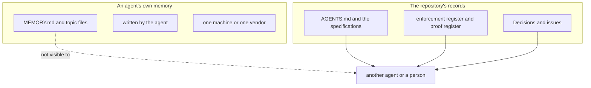

# Why we do not use MEMORY.md

Some coding agents keep notes between sessions: a file, usually `MEMORY.md` with topic files beside it, that the agent writes and reads on its own. This repository does not use such notes for anything the repository must know. The state of the work, the rules, the decisions and the evidence are kept in records that a person, a check and every other agent can read. This page says what the notes are, why they are not used for project state, what is used instead for each kind of state, what an agent may still keep in its own notes, what regulators and standards say about this, and what would change the decision. It is for a senior engineer, a person or an agent, who is new to the repository.

## What MEMORY.md and the other memories are

The mechanisms differ by vendor, and none of them is a standard.

- **Claude Code auto memory.** The agent writes Markdown notes under a folder of its own, `~/.claude/projects/<project>/memory/`, with an index file `MEMORY.md` and topic files, each with a `type` field in its front matter. The notes are local to the machine and are not shared across machines. At the start of a session the first 200 lines or 25 KB of the index are loaded. A person can edit or delete the notes. The documentation shows no audit log, no provenance and no expiry for them.
- **Codex memories.** They are generated in the background under `$CODEX_HOME/memories_v2/`, are off by default and are kept per machine, with secrets redacted. The documentation says to keep required team guidance in `AGENTS.md` or in checked-in documentation, and to treat the memory files as generated state.
- **Copilot Memory.** It stores facts about a repository and preferences of a user. A repository fact cites the code that supports it and is checked against the current branch, which the documentation says is not a guarantee. It expires after 90 days by default, and an organization can set the expiry between 7 and 180 days. It works only in GitHub's own tools.
- **The Anthropic memory tool.** It is a set of file commands that an application implements. Where the notes are kept, who may read them and when they expire are the implementer's work, and the documentation lists expiry and protection against path tricks as the implementer's job.
- **Claude.ai memory.** It keeps topic memories for a user or a project. The enterprise audit log records an owner's toggles and not the individual edits of a person's memories.

They share a shape: free text, written by the agent, scoped to a user, a machine or a vendor's service, and read back into the model's context. That shape is the reason for the decision below, and the places where a vendor adds more, such as Copilot's citations and expiry, are the places where the vendor is solving the same problem for its own tool only.



## Why we do not use them for project state

**Another agent or a person cannot see them.** A note on one machine is invisible to the agent on the next machine, to the person who reviews the work, and to an auditor. A repository's state has to be readable by every reader of the repository, and a file in a home folder is not.

**They have no structure that a check can read.** A note is a paragraph. It has no schema, no author that anything verifies, no source for its claim, no date after which it is wrong, and no way to say that two notes disagree. A statement that was true on Monday sits beside one that is true on Friday, and nothing marks which is current.

**The agent that is wrong writes them.** A note is the agent's own belief, written by the agent, and read back as if it were fact. A wrong note persists and steers the next session. A note that came from content the agent read, such as a page or a file with a hidden instruction, persists the instruction. The research on this is discussed below with its limits, and the mechanism is simple: whatever can write to memory can change what the agent believes later.

**The vendors say the same.** Codex says that required team guidance belongs in `AGENTS.md` or in checked-in documentation and that its memories are generated state. Claude Code's documentation says that its instruction files are "context, not enforced configuration" and points to hooks and managed settings where something must hold. A team that puts its requirements in an agent's private notes is outside what the vendors recommend.

**They bind a repository to a vendor.** The repository is agent agnostic by choice: a person, Claude Code, Codex or another agent should be able to do the work from the same records. A memory that only one tool reads, or that is stored in that tool's own service, makes the next tool start from nothing.

## What the research says, and how much it can be trusted

Three kinds of work bear on the decision, and each comes with a caveat that this page cannot remove.

- **Plain instruction files.** A study from February 2026 (arXiv 2602.11988) is summarized by a secondary source as finding that developer-written `AGENTS.md` files give slight gains and that files generated by a model lower success and raise cost by more than a fifth. This page did not read the paper.
- **Attacks on agent memory.** A line of work on memory injection reports that an attacker who can only send queries can plant a record in an agent's memory (arXiv 2503.03704, March 2025, reported by a search summary as a 98.2 percent injection success rate), and a later paper questions how well that result holds in realistic settings (arXiv 2601.05504, January 2026, also from a search summary). A security firm showed in March 2025 that hidden characters in a rules file could steer two coding assistants, and both vendors treated it as the user's responsibility. That report is older than a year.
- **Typed memory.** A paper from 2026 proposes five primitives that a memory system needs: write authorization, provenance that is visible, retrieval scoped to the principal, the ability to roll back, and verified forgetting (arXiv 2604.16548, submitted 2026-04-17, revised 2026-11-20). Another reports that agents that write typed memory created false authority in up to 45.4 percent of requests that were not authorized, and that the agents that executed them acted on it in 99.0 percent of trials (arXiv 2609.01836, 2026-09-01). The second figure was reported to this page by a research agent and was not verified here, and several preprints from 2026 were read only as search summaries.

The honest reading is that the problem is real, the literature proposes the missing pieces, and no shipped product was found that has all of them. That is also an argument against building one here: the pieces that matter, authority, provenance and evidence, are already what the repository's records do.

## What we use instead, for each kind of state

| Kind of state | Where it lives | What reads it |
| --- | --- | --- |
| Standing instructions | `AGENTS.md` and the constitution, as an index of rules | Every agent, first |
| What must be true | Specifications, as numbered requirements | People, tests, checks |
| What enforces it | The enforcement register of a spec kit | The checks, and a reviewer |
| Which requirements are met, with evidence | The proof register, written by the checks in OSCAL | Anyone, as data |
| A choice that needs authority | A Decision record, signed by the owner | People, and the checks that cite it |
| The state of a body of work | An issue, with `Refs #N` on every commit | `repoctl check` |
| Whether an acceptance scenario passes | A scenario with a test that proves it | The tests |

These are not notes. A requirement has a number and can be cited. An enforcement row says whether a check, a gate or a reviewer enforces it, and says why where none does. The proof register is computed from the tests, so nobody types it. The numbers on the day this page was written come from commands run that day. The enforcement register of the commons spec kit has this many rows of each kind:

```text output="cut -f2 commons/spec-kit/enforcement.tsv | grep -v '^#' | grep -v '^mechanism' | sort | uniq -c; 2026-11-25"
    521 check
      2 gate
     77 none
    206 review
```

And the proof register for commons, written by the checks, holds one finding for each requirement. This script counts the outcome that each finding records:

```ts
const file = "commons/generated/mizan-register-results.auto.oscal.json";
const doc = JSON.parse(await Bun.file(file).text());
const counts: Record<string, number> = {};
for (const finding of doc["assessment-results"].results[0].findings) {
  const outcome = finding.props.find((p: { name: string }) => p.name === "outcome").value;
  counts[outcome] = (counts[outcome] ?? 0) + 1;
}
console.log(counts);
```

```text output="bun count-outcomes.ts, the script above, run from the root of the repository; 2026-11-25"
{
  pass: 310,
  gap: 295,
  accepted: 201,
}
```

A `gap` is a requirement for which the register found no proof that names it, and the register says so in the finding. The numbers are not a score: they show where the repository has evidence and where it does not, and a person or an agent can read which requirements are the gaps. A memory file could not say this, because it would hold the agent's belief and not the register's computation.

## The lessons rule

A mistake that happens twice is a missing requirement, not a missing note. When an agent or a person finds that something went wrong in a way that will recur, the repository's answer is not a line in a memory file saying to be careful. It is one of these, in order of preference:

1. **A requirement with an enforcement row,** and a check that finds the mistake. The mistake is then found by the repository, whoever makes it and whichever agent is running.
2. **A hook or a gate** where a check cannot run in time. The workbench contract's gates are an example: an agent that meets a gate stops and hands back.
3. **A sentence in a guide or in `AGENTS.md`,** with a link, only where nothing can check it, and stated with the reason that it is not checked. An enforcement row of `none` carries that reason.

A lesson that stays a note is a rule that holds only for the agent that happened to read it.

## What an agent may keep in its own memory

An agent's notes may hold what does not matter to anyone else: a preference about how it reports to its user, a habit about the editor, a shortcut it likes. They must not hold anything the repository must know, such as a rule, a decision, a status, a fact about the code, or a reason for a choice. The test is simple: if another agent or a person would need it to do the work correctly, it belongs in a record of the repository, and the agent writes it there, through the repository's own steps, with a ticket. An agent that finds its notes holding such a thing moves it and deletes the note.

## What regulators and standards say

This page looked for what regulators and standards say about an agent's working memory and found nothing that addresses it as such. The search was limited: US, EU and NIST sources and a few standards bodies, through a tool that returns summaries, and several standards (the ISO texts and the AICPA criteria) were not readable. What was found is general, and it is the same in every source: a record that matters has to be attributable, time-stamped, protected and validated.

- **Electronic records and signatures in the United States.** 21 CFR 11.10(e) requires "secure, computer-generated, time-stamped audit trails to independently record the date and time of operator entries", 11.10(a) requires "limiting system access to authorized individuals", and 11.50 requires a signed record to show the printed name, the date and time and the meaning of the signature (the text read is the eCFR as of 2026-11-01). Nothing in them mentions artificial intelligence.
- **The quality system regulation.** It incorporates ISO 13485 and took effect on 2026-02-02, according to a secondary summary. The standard's clauses on the control of records and on the validation of software in the quality system were read through secondary sources only.
- **NIST SP 800-171 Revision 3** (May 2024, read directly) asks for audit records that give the source of an event and the identity of the individuals, subjects or entities associated with it (03.03.02), and for configuration changes that are reviewed, approved and documented (03.04.03). It does not mention agent memory.
- **The draft EU GMP Annex 22** on artificial intelligence (a consultation from 2025-07-07 to 2025-10-07, read directly from the draft) says that it does not apply to generative models and large language models, and that such models "should not be used in critical GMP applications". For uses that are not critical, trained personnel stay responsible, with a human in the loop. Its final status was not found.
- **The EU AI Act.** Article 12 asks that high-risk systems record events automatically, and Article 14 asks that people can oversee them (an unofficial mirror of the text was read). They apply to the system as a product, not to a developer's use of an agent.
- **NIST AI 600-1** (the generative AI profile, 2024-07-26, read directly) asks for inventories of generative AI systems with data provenance, and names autonomous agents as a security concern.
- **Provenance vocabularies.** The W3C's PROV-O (2013-04-30) models an agent acting on behalf of another, which is the closest existing vocabulary for an agent working for a person.
- **Attribution of agent-authored commits.** The Linux kernel's guide for coding assistants says an agent must not add a `Signed-off-by` tag and asks for an `Assisted-by` trailer, with the human taking responsibility. An individual Internet-Draft proposes trailers for the human, a bot under delegation and an AI model (2026-11-18, not endorsed by the IETF). No regulator's text was found on whether an agent may commit under a person's identity.

What follows is a reading, not legal advice. What regulators require of records is technology neutral: an audit trail, access control, validation, change control and signatures that carry their meaning. The repository's records are the ones that give these, to the extent that Git, the specifications, the registers and the Decisions give them, and [the Decision on the attribution of agent work](../../spec-kit/audits/2026-11-agent-attribution.md) says plainly where they do not: it is not an electronic signature in the sense of Part 11, published commits can be rewritten until branch protection is set, and the person of record does not read each commit. An agent's private notes would add a record with none of these properties.

## When we would revisit

The decision is a judgment on the evidence found, and these would change it:

- **A quality auditor or a customer asks to see an agent's working notes,** which would make them a record that has to be controlled.
- **A controlled comparison shows a large gain** from an agent's own memory on tasks of this repository, with the errors counted. Reading the notes costs tokens and carries the risks above, so the gain would have to be large and measured, not described.
- **A vendor ships memory that is shared, typed, attributed, expiring and auditable** and that works across agents. Copilot Memory has some of these for GitHub's tools. A cross-agent version would be worth a look.

Until then the answer is the one this page gives: the repository's records are the memory, and the agents read them.

## Sources

The pages of the vendors were read on 2026-11-25 through a tool that returns summaries from a small model. Pages marked undated showed no publication date. Entries marked secondary were read through a secondary source or a search summary and not from the source itself.

- Claude Code memory and auto memory: `code.claude.com/docs/en/memory` (undated). Subagent memory: `code.claude.com/docs/en/sub-agents` (undated).
- The Anthropic memory tool: `platform.claude.com/docs/en/agents-and-tools/tool-use/memory-tool` (undated).
- Claude.ai memory: `support.claude.com`, article 11817273 (undated; it mentions organization defaults from 2026-10-31).
- Codex memories: `learn.chatgpt.com/docs/customization/memories` (undated).
- GitHub Copilot Memory: `docs.github.com/en/copilot/concepts/agents/copilot-memory` (undated).
- A study of `AGENTS.md` files: arXiv 2602.11988 (2026-02-12), secondary.
- Memory injection: arXiv 2503.03704 (2025-03), secondary; a later reassessment, arXiv 2601.05504 (2026-01), secondary. Rules File Backdoor, Pillar Security (2025-03), secondary and older than a year.
- Primitives of a governed memory: arXiv 2604.16548 (2026-04-17, revised 2026-11-20), secondary.
- Typed memory and false authority: arXiv 2609.01836 (2026-09-01, revised 2026-10-24), secondary and not verified.
- 21 CFR Part 11, sections 11.10 and 11.50: the eCFR as of 2026-11-01.
- The quality system regulation: the Federal Register notice of 2024-02-02 and the FDA page, secondary.
- NIST SP 800-171 Revision 3 (May 2024) and NIST AI 600-1 (2024-07-26): read directly.
- The draft EU GMP Annex 22 and its consultation (2025-07-07 to 2025-10-07): read directly.
- The EU AI Act, Articles 12 and 14: an unofficial mirror, `artificialintelligenceact.eu` (undated).
- W3C PROV-O, a recommendation of 2013-04-30.
- The Linux kernel's guide for coding assistants, `docs.kernel.org/7.1/process/coding-assistants.html` (date not captured). The individual Internet-Draft `draft-morrison-identity-attributed-commits-05` (2026-11-18).
- Not read, and so not relied on: the texts of ISO 13485, ISO/IEC 42001 and ISO/IEC 27001, and the AICPA criteria.
